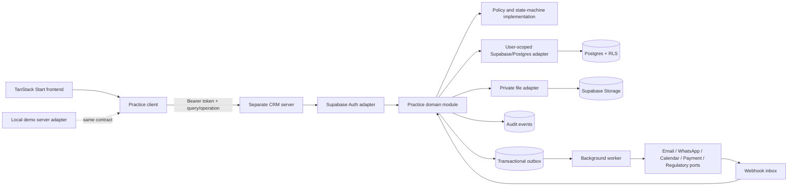

# SN Practice CRM — Target Architecture

## Decision summary

SN Practice CRM will move from browser-owned table access to a **separate application server** with a deep practice-domain module. The frontend calls a small typed query/operation interface. The server owns authorization, state transitions, financial invariants, idempotency, audit evidence, asynchronous work, and external credentials.

Supabase Auth, Postgres, Storage, and the existing RLS policies remain part of the architecture. The server strengthens the current permission model; it does not replace RLS with unverified browser claims or an unrestricted service-role client.

The initial deployment is single-firm. A firm identifier, if stored, is resolved by the server and is never selected by the caller.

## Architectural principles

1. **Intent, not table CRUD.** Callers request `assignment.submitForReview` or `receipt.allocate`, never `update(table, patch)`.
2. **RLS remains defence in depth.** Navigation and frontend checks improve usability but do not grant access.
3. **The interface is the test surface.** Production, demo, and migration adapters must pass the same contract tests.
4. **One command, one transaction.** Domain change, version increment, audit event, and outbox record commit or fail together.
5. **Safe retries.** Every operation is idempotent and every mutable aggregate uses optimistic concurrency.
6. **External calls are asynchronous.** Database commits do not wait for WhatsApp, email, calendar, payment, signing, or regulator providers.
7. **Money and issued records are controlled.** Invoice totals are derived, allocations are locked and checked, and corrections use compensating records.
8. **Demo parity.** Local preview uses the same HTTP contract and domain behavior without production credentials.

## Runtime view



## Modules, seams, and adapters

### Frontend practice client

The frontend imports one client rather than importing Supabase inside routes. It provides caller-friendly TanStack Query options and consistent error handling:

```ts
useQuery(crm.query("dashboard.get", { view: "auto" }));

useMutation(crm.operation("assignment.submitForReview"));
```

It is responsible for:

- attaching the current Supabase access token;
- generating request and idempotency identifiers;
- decoding the typed outcome;
- standardising retry behavior; and
- invalidating affected read-model caches.

It is not responsible for determining whether a command is legal.

### Practice-domain module

The server exposes a deep module with two entry points:

```ts
interface PracticeDomain {
  query<K extends keyof QueryMap>(
    context: ActorContext,
    request: { type: K; input: QueryMap[K]["input"] },
  ): Promise<Outcome<QueryMap[K]["output"]>>;

  execute<K extends keyof OperationMap>(
    context: ActorContext,
    request: OperationEnvelope<K>,
  ): Promise<Outcome<OperationReceipt<OperationMap[K]["output"]>>>;
}
```

Its implementation hides:

- permission and record-scope evaluation;
- state machines and preconditions;
- numbering and financial calculation;
- optimistic concurrency;
- idempotency reservation and replay;
- transaction management;
- audit-event and domain-event creation;
- outbox creation; and
- provider-independent business rules.

Internally, handlers may be organised by client lifecycle, obligations, work, documents, billing, collections, and administration. Those are internal seams, not additional caller interfaces.

### Dependency categories

| Dependency                                        | Category                       | Production adapter                    | Test/demo adapter                                           |
| ------------------------------------------------- | ------------------------------ | ------------------------------------- | ----------------------------------------------------------- |
| Postgres and RLS                                  | Local-substitutable            | User-scoped Supabase/Postgres adapter | Local Supabase or PGLite-compatible adapter                 |
| Object storage and scanner                        | Local-substitutable / external | Private Supabase Storage plus scanner | Local files or in-memory objects plus deterministic scanner |
| Background worker                                 | Remote but owned               | Queue/outbox worker                   | In-process drainable worker                                 |
| Email, WhatsApp, calendar, payment, e-sign        | True external                  | Provider-specific adapters            | Capturing/failure-injection adapters                        |
| GST, Income Tax, MCA and other regulator channels | True external                  | Authorised provider/agency adapters   | Contract stubs and sandbox adapters                         |
| Clock and ID generation                           | In-process                     | System clock and secure IDs           | Fixed clock and deterministic IDs                           |

Do not introduce a provider port without a production and test adapter. Provider-specific types stop at the adapter.

## Authentication and RLS-preserving authorization

### Interactive request path

1. The browser signs in through Supabase Auth.
2. The browser sends its access token to the CRM server as `Authorization: Bearer <token>`.
3. The server verifies the token through the Supabase Auth/JWKS path and derives the immutable user subject, session, and assurance level.
4. The server resolves the staff profile, active status, roles, departments, record scopes, and any access grants from trusted storage.
5. Ordinary data operations run through a user-scoped Supabase adapter that forwards the verified user token, so existing `auth.uid()` and RLS helper policies continue to apply.
6. Atomic multi-table operations use reviewed database functions/RPCs or an equivalently RLS-aware transaction adapter. They do not silently switch to an unrestricted service role.
7. The domain module performs operation-level authorization and invariants in addition to RLS.

Supabase documents that publishable keys are safe only in combination with RLS and least privilege, while service-role and secret keys bypass RLS and must never be exposed to the frontend. See [Securing your data](https://supabase.com/docs/guides/database/secure-data) and [Row Level Security](https://supabase.com/docs/guides/database/postgres/row-level-security).

### Privileged and system operations

- Existing privileged patterns are retained: verify founder/authorised capability with the caller-scoped client before loading an administrative client.
- A service-role adapter may be used only inside an allow-listed privileged or system handler.
- The service-role client is created after authorization, never at route-module load time.
- Every privileged operation requires an audit event; selected operations require AAL2 step-up.
- Background jobs use a named system actor with command-specific capability and causation ID, not a synthetic unrestricted user.
- Disabling a staff account takes effect on the next domain call even if the frontend still displays cached controls.

Supabase provides MFA assurance-level claims that can be enforced in application logic and RLS. See [Supabase MFA](https://supabase.com/docs/guides/auth/auth-mfa).

## HTTP contract

The wire contract is versioned independently of the UI.

### Query

```http
POST /v1/query
Authorization: Bearer <access-token>
X-Request-ID: <uuid>
Content-Type: application/json

{
  "type": "dashboard.get",
  "input": { "view": "auto" }
}
```

Queries are permission-filtered and side-effect free except for narrowly defined sensitive-access logging. Lists use cursor pagination. Dashboard results carry one `asOf` timestamp so cards and charts reconcile.

### Operation

```http
POST /v1/operations
Authorization: Bearer <access-token>
X-Request-ID: <uuid>
Idempotency-Key: <uuid>
Content-Type: application/json

{
  "type": "assignment.submitForReview",
  "expectedVersion": 7,
  "input": {
    "assignmentId": "...",
    "submissionNote": "Ready for review"
  }
}
```

The actor, firm, timestamps, business codes, audit metadata, invoice number, and derived totals never come from authoritative caller input.

### Typed outcome

```ts
type Outcome<T> =
  { ok: true; value: T; requestId: string } | { ok: false; error: DomainError; requestId: string };

type DomainError =
  | { code: "UNAUTHENTICATED" }
  | { code: "FORBIDDEN" }
  | { code: "STEP_UP_REQUIRED"; assurance: "aal2" }
  | { code: "NOT_FOUND" }
  | { code: "VALIDATION_FAILED"; fields: Record<string, string> }
  | { code: "PRECONDITION_FAILED"; failures: PreconditionFailure[] }
  | { code: "INVALID_STATE"; state: string; allowedOperations: string[] }
  | { code: "VERSION_CONFLICT"; currentVersion: number }
  | { code: "IDEMPOTENCY_KEY_REUSED" }
  | { code: "RATE_LIMITED"; retryAfterSeconds: number }
  | { code: "DEPENDENCY_UNAVAILABLE"; retryable: boolean }
  | { code: "UNEXPECTED" };
```

Database, Supabase, storage, and provider errors are never returned verbatim.

## Query vocabulary

Core queries are shaped for real callers rather than mirroring tables:

- `actor.context`
- `dashboard.get`
- `client.list`
- `client.workspace`
- `engagement.workspace`
- `obligation.calendar`
- `assignment.queue`
- `assignment.workspace`
- `task.myQueue`
- `document.inbox`
- `document.workspace`
- `billing.workspace`
- `collections.workspace`
- `report.run`
- `admin.workspace`
- `audit.timeline`
- `operation.status`

Workspace queries return the aggregate version and permission-filtered `availableActions`. The UI uses those actions for affordances but the server reauthorizes every operation.

## Operation vocabulary

Core operations express business intent:

- `client.createProspect`, `client.updateProfile`, `client.submitForAcceptance`, `client.decideAcceptance`, `client.suspend`, `client.close`;
- `engagement.createDraft`, `engagement.activate`, `engagement.amend`, `engagement.end`;
- `obligation.schedule`, `obligation.materializePeriod`, `obligation.overrideDeadline`, `obligation.waive`;
- `assignment.assign`, `assignment.start`, `assignment.setAwaitingClient`, `assignment.resume`, `assignment.setChecklistItem`, `assignment.submitForReview`, `assignment.requestChanges`, `assignment.approve`, `assignment.recordFiling`, `assignment.complete`, `assignment.reopen`;
- `document.request`, `document.beginUpload`, `document.confirmUpload`, `document.review`, `document.supersede`;
- `invoice.createDraft`, `invoice.submitForApproval`, `invoice.requestChanges`, `invoice.approve`, `invoice.issue`, `invoice.issueCreditNote`, `invoice.issueDebitNote`, `invoice.cancel`;
- `receipt.record`, `receipt.allocate`, `receipt.reverseAllocation`, `receipt.reverse`, `collection.recordFollowUp`;
- `staff.invite`, `staff.deactivate`, `staff.replaceAccess`;
- `organisation.updateSettings`;
- `workflow.publishVersion`, `deadlineRule.publishVersion`, `policy.publishReminderRules`; and
- `communication.queue` and `communication.cancel`.

There is deliberately no generic `updateStatus`, `patchRecord`, or public table name in the contract.

## Command processing

For every operation, the module performs this ordered implementation:

1. authenticate and resolve the current actor;
2. parse and validate the operation payload;
3. reserve the idempotency key and compare the canonical payload hash;
4. load the aggregate under the actor’s RLS context;
5. authorise the operation and field scope;
6. compare `expectedVersion`;
7. evaluate state, evidence, maker-checker, and financial preconditions;
8. apply the change and increment the aggregate version;
9. append the redacted audit event and domain events;
10. append outbox work; and
11. commit and return the durable operation receipt.

If any step fails, no domain change, audit event, or outbox record commits.

## Idempotency and concurrency

- Every operation requires an idempotency key scoped to the authenticated actor and operation family.
- The server stores the canonical payload hash, processing status, result reference, and response.
- Repeating the same key and hash replays the original durable receipt.
- Repeating the key with a different hash returns `IDEMPOTENCY_KEY_REUSED`.
- Mutations of existing aggregates require `expectedVersion` from the latest workspace query.
- A stale version returns `VERSION_CONFLICT`; the server never silently overwrites another user’s work.
- Financial allocations additionally lock the receipt and affected invoices, including invoices removed by a replacement allocation.

## Maker-checker and approval semantics

- Submission and approval are separate operations and audit events.
- An approval binds to the exact submitted version or payload hash.
- A later material edit invalidates the prior approval.
- The preparer cannot be the reviewer for a controlled assignment.
- Invoice preparation and issue may be separated by policy and threshold.
- Receipt reversal, write-off, credit note, access change, and client-money movement require a reason and may require a second approver.
- An approver losing permission before approval causes the operation to fail even if the UI was already open.

## Audit ledger

An audit event contains:

- immutable event ID and monotonic sequence;
- operation ID, request ID, correlation ID, and causation ID;
- server-resolved actor, session, and assurance level;
- subject type, subject ID, action, and resulting version;
- business reason where required;
- redacted before/after patch or hashes;
- server timestamp and source adapter; and
- related domain and outbox event IDs.

The audit ledger is append-only and separately permissioned. Corrections create new events. Comments and activity feed entries remain editable operational content and never substitute for audit evidence.

Sensitive reads such as export, document download, PAN/bank reveal, client-money access, and audit-log access create access events. Routine list reads go to security telemetry to avoid an unusable business ledger.

## Transactional outbox and webhook inbox

- Provider work is appended to `outbox_events` in the same transaction as the originating operation.
- Workers claim records with a safe lease, record attempts, use exponential backoff with jitter, and move exhausted work to a visible dead-letter queue.
- Provider idempotency identifiers and response references are persisted.
- Webhooks first enter an idempotent inbox keyed by provider and provider-event ID.
- Webhook verification happens before any domain operation.
- A webhook cannot directly patch business tables; it invokes a named operation with a provider actor and causation ID.
- Users see `queued`, `sent`, `delivered`, `failed`, and `action required` states rather than a false synchronous success.

## Documents and storage

- Buckets remain private.
- The server issues short-lived upload instructions only after authorizing a document request.
- Storage paths are opaque and derived by the server.
- Confirmation verifies size, media type, checksum, and ownership before creating a version.
- New versions remain quarantined until scan completion.
- RLS protects storage metadata and object access; service keys are confined to reviewed server handlers.
- Downloads use short-lived URLs and create sensitive-access events.

Supabase Storage uses RLS policies on storage metadata and warns that service keys bypass those controls. See [Storage access control](https://supabase.com/docs/guides/storage/security/access-control).

## Local demo server adapter

The target demo is a local server, not a set of unrelated browser-only branches.

```text
TanStack frontend
  → same PracticeClient
  → http://localhost:<demo-port>/v1
  → same PracticeDomain interface
  → seeded local database + private local object store
  → capturing email/WhatsApp/payment adapters
```

Requirements:

- no Lovable Cloud or external provider credentials;
- deterministic seed data representing every role and important state;
- one-command reset to the known seed;
- a visible `Demo` environment indicator;
- no outbound message, filing, payment, or signing side effect;
- captured provider messages inspectable in the demo UI;
- the same contract, permission, state-machine, allocation, idempotency, and audit tests as production; and
- safe startup on a documented port so Live Server is not required.

The current browser-local demo implementation remains a migration adapter until the local server reaches parity. It is then removed rather than maintained as a second business implementation.

## Migration from direct Supabase access

Migration is vertical and reversible:

1. **Inventory and freeze behavior.** Record every route’s queries, mutations, permissions, loading/error states, and demo behavior.
2. **Introduce the PracticeClient.** Routes call a typed client. A temporary Supabase-compatibility transport may continue existing behavior.
3. **Build server authentication and health.** Verify Supabase tokens, resolve the actor, and run RLS contract tests.
4. **Move dashboard reads.** Replace the current multi-query client calculation with `dashboard.get` and compare metrics against the old route.
5. **Move one complete workflow.** Client workspace plus assignment maker-checker is the first write vertical slice.
6. **Move documents.** Add private upload/version/scan behavior before removing metadata-only writes.
7. **Move billing and collections.** Preserve numbering and allocation triggers while commands take ownership of approval and reversals.
8. **Move administration and integrations.** Preserve the existing founder-check-before-admin-client pattern.
9. **Close direct writes.** Remove browser write paths and narrow grants only after route and contract parity passes.
10. **Remove migration adapters.** Delete direct-Supabase and browser-local business logic when no route depends on them.

Each slice retains a feature flag or route-level rollback until its data migration, parity tests, and audit checks pass. Do not run two write implementations for the same operation after cutover.

## Data-model additions

The implementation is expected to add or sharpen:

- prospects and acceptance decisions;
- client legal entities, beneficial owners, registrations, and access grants;
- engagement versions and acceptance evidence;
- obligation rules, rule versions, obligations, deadline overrides, and source evidence;
- aggregate versions and assignment review submissions/decisions;
- document requests, upload sessions, document versions, scan results, and retention/hold metadata;
- invoice approvals, tax components, credit/debit notes, reversals, and disputes;
- operation idempotency receipts;
- append-only audit events;
- domain events, outbox events, provider attempts, and webhook inbox;
- notifications and failed-action queues; and
- optional time, rate, budget, WIP, and capacity records for the advanced phase.

Free-text statuses are replaced by constrained state values and intent-specific transitions. Historical values are mapped, never discarded.

## Security, observability, and recovery

- Structured logs include request, operation, correlation, and actor references but redact tokens, PAN, bank details, document contents, and provider secrets.
- Metrics cover latency, error code, RLS denial, version conflict, idempotent replay, queue age, delivery failure, webhook rejection, and database saturation.
- Traces connect the HTTP request, transaction, outbox job, provider attempt, and webhook.
- Rate limits apply by actor, IP, operation family, and sensitive export volume.
- Production secrets live only in server/worker secret management and are rotated.
- Database backups and point-in-time recovery are configured to the agreed RPO; restoration is exercised, not assumed. Supabase documents daily backups and paid-plan PITR availability in its [database overview](https://supabase.com/docs/guides/database/overview).
- Security-event retention and incident procedures must support applicable Indian requirements. CERT-In’s directions specify a rolling 180-day secure ICT-log period for covered entities; applicability must be confirmed for the firm and hosting arrangement. See the [CERT-In directions](https://cert-in.org.in/PDF/CERT-In_Directions_70B_28.04.2022.pdf).

## Verification strategy

The interface is the primary test surface:

- contract tests run against production-like HTTP, local demo, and temporary migration adapters;
- RLS tests attempt horizontal and vertical privilege escalation for every table, view, function, and storage path;
- state-machine tests cover every allowed and forbidden transition;
- maker-checker tests include self-review, stale approval, reassignment, and permission revocation;
- property tests cover invoice totals, allocation conservation, credit/reversal behavior, and rounding;
- concurrency tests submit the same and conflicting operations in parallel;
- idempotency tests replay before, during, and after failure;
- outbox/webhook tests inject timeouts, duplicates, reordering, and invalid signatures;
- backup restoration and migration rollback are exercised in a non-production environment; and
- end-to-end tests cover the role dashboards and core client-to-collection lifecycle.

Tests that assert old route-internal Supabase call sequences should be replaced by tests through the domain interface once a slice migrates.

## Deliberate trade-offs

- The operation registry will grow, but explicit intent is safer than generic patch endpoints.
- Screen-shaped queries duplicate some read-model code, but give callers consistent, fast views and centralise metric definitions.
- The two-entry-point external interface could hide an internal monolith; internal handler modules and ownership keep implementation locality without exposing extra seams.
- RLS-aware server transactions are more work than using a universal service role, but they preserve the project’s strongest existing security control.
- Provider interactions are eventually consistent, so the UI must show pending and failed states.
- Single-firm operation simplifies the caller interface. A future commercial SaaS conversion still requires a deliberate tenancy and isolation review.
