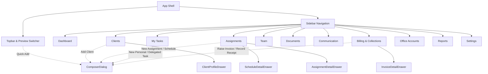

# Desktop UI Behavioral, Visual, and Authority Baseline

- **Canonical Target Path:** `sn-practice-crm/apps/web/src/app.tsx`
- **Target Repository Root:** `C:\Users\HP\Mohammed\CRM`
- **Accepted Parent Commit:** `041f15e`
- **Document Status:** Authoritative Pre-Integration Baseline (Task CRM-P0-T3)
- **Scope Boundary:** Desktop application only (viewport width ≥ 1280px; HTML min-width 1180px). Mobile layouts and responsive drawer transformations are explicitly deferred to post-integration phases.

---

## 1. Provenance and Scope

### 1.1 Source Files Inspected

| Source Path | Type | Size / Lines | Key Responsibilities & Observed Exports |
| :--- | :--- | :--- | :--- |
| `sn-practice-crm/apps/web/src/app.tsx` | TSX Component Shell | 245,034 bytes / 5,876 lines | Top-level state container (`App`), shell navigation (`Sidebar`, `Topbar`), role-based dashboards (`FounderDashboard`, `ManagerDashboard`, `SeniorDashboard`, `StaffDashboard`, `TraineeDashboard`), workspace views (`ClientsWorkspace`, `AssignmentsWorkspace`, `BillingWorkspace`, `AccountsWorkspace`, `TeamWorkspace`, `ModuleFoundation`), slide-over drawers (`ClientProfileDrawer`, `ScheduleDetailDrawer`, `AssignmentDetailDrawer`, `InvoiceDetailDrawer`), and composer modals (`ComposerDialog`). |
| `sn-practice-crm/apps/web/src/data.ts` | TypeScript Data & Types | 32,010 bytes / 1,028 lines | In-memory initial records (`ASSIGNMENTS`, `CLIENTS`, `CLIENT_OUTSTANDING`, `DELEGATED_TASKS`, `INVOICES`, `PERSONAL_TASKS`, `RECEIPTS`, `RECURRING_SCHEDULES`, `ROLE_COPY`, `ROLE_LABELS`, `ROLE_PEOPLE`), TypeScript interfaces, and currency formatting helper (`formatINR`). |
| `sn-practice-crm/packages/domain/src/authority.ts` | Domain Logic | 6,569 bytes / 163 lines | Pure domain authority engine (`authorize`, `validateReportingLine`, `COMPANY_ROLES`, `Actor`, `EmployeeRef`, `AuthorityRequest`, `AuthorityDecision`). |
| `sn-practice-crm/packages/domain/src/authority.test.ts` | Vitest Suite | 5,516 bytes / 119 lines | 24 automated unit tests verifying practice leadership privileges, delegation constraints, personal task boundaries, and reporting line hierarchies. |
| `sn-practice-crm/apps/web/src/styles.css` | CSS Stylesheet | 55,951 bytes / 3,187 lines | Horizon-derived executive design tokens (`--canvas`, `--surface`, `--ink`, `--brand`, `--shadow-card`), typography scales, desktop grid layouts, drawer transitions, and interaction states. |
| `sn-practice-crm/package.json` | Manifest | 299 bytes / 11 lines | Target build, dev, and test scripts (`vite`, `vitest`, `tsc`). |

### 1.2 Verification Command and Results

The target domain suite was executed directly against `sn-practice-crm`:

```bash
npm --prefix sn-practice-crm test
```

- **Runner:** Vitest v4.1.12
- **Test File:** `packages/domain/src/authority.test.ts`
- **Result:** Exactly 24 passed (24 total tests in 1 test file) across all runs
- **Exit Code:** 0
- **Execution Verification:** Both the implementation worker's reported run (572 ms) and the supervisor's independent run (595 ms) passed 24/24 with exit code 0. Duration is non-contractual and varies across execution environments; therefore, a single authoritative duration is omitted.

### 1.3 Persistence Status

- **Observed Persistence Mode:** In-memory ephemeral React state (`useState`).
- **Initial Hydration:** State is initialized from static arrays in `data.ts` (`ASSIGNMENTS`, `CLIENTS`, `RECURRING_SCHEDULES`, `INVOICES`, `RECEIPTS`, `PERSONAL_TASKS`, `DELEGATED_TASKS`).
- **Data Lifecycle:** All client additions, assignment creations, subtask delegations, invoice generations, receipt recordings, and milestone toggles exist strictly in browser RAM during the active session.
- **Backend Connectivity:** There is **zero active API communication, zero Supabase client instantiation, and zero localStorage caching** wired into `app.tsx`. Refreshing or closing the tab resets all modifications to the initial mock fixtures.

---

## 2. Application Shell and Navigation

### 2.1 Proportions and Desktop Shell Architecture

The application layout is defined in `styles.css` (lines 91–106) and rendered by `App` (`app.tsx`, lines 566–671):

- **Grid Proportions:** `.app-shell` uses a CSS grid with `grid-template-columns: var(--sidebar-width) minmax(0, 1fr)`.
- **Sidebar Width:** Fixed at `248px` (`--sidebar-width: 248px`).
- **Viewport Constraints:** `html` is constrained by `min-width: 1180px` (`styles.css`, line 42). Desktop operation is engineered for `1280px+`.
- **Sidebar Compact Behavior:** In the target UI code, there is **no compact collapsible toggle or icon-only collapsed state** implemented. The sidebar remains fixed at 248px width, with `.nav-scroll` handling vertical overflow.

### 2.2 Shell Components

#### Preview Banner (`app.tsx`, lines 570–585)
- Rendered above the Topbar across all routes.
- Displays a `Sparkles` icon with the text: `Clean-slate preview · permission-aware demo data`.
- Features an interactive role switcher `<select>` labeled `Preview as`:
  - Options: `Founder`, `Manager`, `Senior Staff`, `Staff`, `Trainee`.
  - Switching immediately updates `role` state, resets `activePage` to `'Dashboard'`, and fires a toast confirmation (`Preview switched to [Role]`).

#### Topbar (`app.tsx`, lines 731–766)
- **Breadcrumb:** Displays `Workspace / [activePage]` and a bold current page title (`Main dashboard` when on Dashboard).
- **Search Control (`search-control`):** Input with placeholder `Search clients, PAN, GSTIN…`. Pressing `Enter` triggers a feedback toast: `Search is ready for API wiring`.
- **Notification Icon (`Bell`):** Includes a red indicator dot (`.has-indicator`). Clicking triggers a toast: `Three items need attention`.
- **Quick Add Icon (`Plus`):** Triggers `openPrimaryAction()`:
  - If actor has `assignment.create` authority (`founder` or `manager`), opens the `assignment` creation modal.
  - If non-leadership (`senior_staff`, `staff`, `trainee`), opens the `personal` task creation modal.
- **User Avatar:** Circular initial badge (`SN`, `AR`, `PD`, `RM`, `NK`) rendered from the active role persona.

#### Sidebar (`app.tsx`, lines 674–730)
- **Brand Header:** Interactive button navigating to `Dashboard`, displaying monogram `SN`, title `SN Practice CRM`, and subtitle `SN & Associates`.
- **Navigation Groups (`ALL_NAV`, lines 99–121):**
  - Group 1 — **Workspace:** `Dashboard` (`LayoutDashboard`), `Clients` (`Building2`), `Assignments` (`BriefcaseBusiness`), `My Tasks` (`ListChecks`).
  - Group 2 — **Practice:** `Team` (`UsersRound`), `Documents` (`Files`), `Communication` (`MessageSquareText`), `Billing & Collections` (`ReceiptIndianRupee`), `Office Accounts` (`WalletCards`), `Reports` (`TrendingUp`).
  - Group 3 — **System:** `Settings` (`Settings2`).
- **Sidebar Footer:** Interactive profile card button displaying persona avatar, employee name, role title (`ROLE_LABELS[role]`), and `ChevronRight`.

### 2.3 Reachable Views and Drawer/Modal States



| View ID / Key | Role Access | Top-Level Route Purpose | Associated Drawers / Sub-Views | Associated Modals (`ComposerDialog`) |
| :--- | :--- | :--- | :--- | :--- |
| `Dashboard` | All 5 Roles | Role-customized operational and executive command center. | `AssignmentDetailDrawer` (via table row / link clicks). | `assignment` (leadership) or `personal` (non-leadership). |
| `Clients` | Founder, Manager, Senior Staff, Staff | Client master directory, tax credentials, and engagement portfolios. | `ClientProfileDrawer` (5 tabs: Overview, KYC, Schedules, Work, Billing). | `client` modal (leadership only). |
| `Assignments` | Founder, Manager, Senior Staff, Staff | Continuous statutory compliance tracking and one-off assignments. | `ScheduleDetailDrawer` (3 tabs), `AssignmentDetailDrawer` (4 tabs). | `assignment` (leadership only). |
| `My Tasks` | All 5 Roles | Personal planning, reminders, and operational delegated subtasks. | None (inline task checking and submission). | `personal` task modal, `delegated` subtask modal. |
| `Team` | Founder, Manager | Reporting lines tree and practice authority guardrails. | None. | None. |
| `Documents` | All 5 Roles | Client evidence, working papers, and statutory document requests. | `ModuleFoundation` placeholder. | None. |
| `Communication` | All 5 Roles | Client interaction log, emails, calls, and follow-ups. | `ModuleFoundation` placeholder. | None. |
| `Billing & Collections` | Founder, Manager, Senior Staff, Staff (Trainee restricted) | Invoices, client ageing analysis, receipt allocations, and follow-ups. | `InvoiceDetailDrawer` (invoice summary & quick pay). | `invoice` (leadership only), `receipt` (all billing roles). |
| `Office Accounts` | Founder, Manager | Manager-operated petty cash ledger, office expenses, and cash reconciliation. | None (inline `CashLedger` card). | None. |
| `Reports` | Founder, Manager, Senior Staff | Practice performance, delivery readiness, and collection metrics. | `ModuleFoundation` placeholder. | None. |
| `Settings` | Founder only | Practice configuration, number sequences, and staff access control. | `ModuleFoundation` placeholder. | None. |

---

## 3. Role and Authority Matrix

### 3.1 Personas and Stored Identities

The codebase maps five canonical practice personas (`data.ts`, lines 3–17; `authority.ts`, lines 1–8):

| Role UI Label | Internal Role Key | Stored Persona ID | Person Name | Initials | Reporting Manager |
| :--- | :--- | :--- | :--- | :--- | :--- |
| **Founder** | `'founder'` | `'founder-sn'` | S. Narayanan | `SN` | *None (Practice Head)* |
| **Manager** | `'manager'` | `'manager-ananya'` | Ananya Rao | `AR` | S. Narayanan (Founder) |
| **Senior Staff** | `'senior_staff'` | `'senior-priya'` | Priya Desai | `PD` | Ananya Rao (Manager) |
| **Staff** | `'staff'` | `'staff-rohan'` | Rohan Mehta | `RM` | Ananya Rao (Manager) |
| **Trainee** | `'trainee'` | `'trainee-neha'` | Neha Kapoor | `NK` | Ananya Rao (Manager) |

### 3.2 Granular Permissions and Capabilities Matrix

| Capability / Resource | Founder | Manager | Senior Staff | Staff | Trainee | Implementation Status & Source Anchor |
| :--- | :---: | :---: | :---: | :---: | :---: | :--- |
| **Navigation: Dashboard** | Full | Full | Scoped | Scoped | Execution | **Implemented:** `ROLE_NAV` (`app.tsx`, lines 123–169). |
| **Navigation: Clients** | Visible | Visible | Visible | Visible | Hidden | **Implemented:** `ROLE_NAV`. |
| **Navigation: Assignments** | Visible | Visible | Visible | Visible | Hidden | **Implemented:** `ROLE_NAV`. |
| **Navigation: My Tasks** | Visible | Visible | Visible | Visible | Visible | **Implemented:** `ROLE_NAV`. |
| **Navigation: Team** | Visible | Visible | Hidden | Hidden | Hidden | **Implemented:** `ROLE_NAV`. |
| **Navigation: Billing & Collections** | Visible | Visible | Visible (Scoped) | Visible (Scoped) | Hidden (Restricted) | **Implemented:** `ROLE_NAV` + guard in `BillingWorkspace` (`app.tsx`, line 3797). |
| **Navigation: Office Accounts** | Visible | Visible | Hidden | Hidden | Hidden | **Implemented:** `ROLE_NAV`. |
| **Navigation: Reports** | Visible | Visible | Visible | Hidden | Hidden | **Implemented:** `ROLE_NAV`. |
| **Navigation: Settings** | Visible | Hidden | Hidden | Hidden | Hidden | **Implemented:** `ROLE_NAV`. |
| **Create New Client** | Yes | Yes | No | No | No | **Implemented:** Button guarded by `leadership` (`app.tsx`, line 1925). |
| **Edit Client Master Details** | Yes | Yes | Read-Only | Read-Only | N/A | **Implemented:** `canFullEdit` guard in drawer (`app.tsx`, line 2108). |
| **Create Client Assignment** | Yes | Yes | Denied | Denied | Denied | **Implemented:** `authorize({ action: 'assignment.create' })` (`authority.ts`, line 105). |
| **Assign Assignment Owner** | Any non-Trainee | Any non-Trainee | Denied | Denied | Denied | **Implemented:** `trainee_cannot_own_assignment` check (`authority.ts`, line 113). |
| **Delegate Subtask** | Any subordinate | Senior, Staff, Trainee | Staff, Trainee | Trainee Only | Denied | **Implemented:** `mayDelegateTo` hierarchy (`authority.ts`, lines 57–70). |
| **Create Personal Task** | Self only | Self only | Self only | Self only | Self only | **Implemented:** `personal_task_must_be_self_owned` (`authority.ts`, line 144). |
| **Progress/Update Milestone** | Leadership/Owner | Leadership/Owner | Assigned Owner | Assigned Owner | Assigned Owner | **Implemented:** `isAssignedCustodian` checks in drawers (`app.tsx`, line 4567). |
| **Submit Task for Review** | N/A | N/A | Reviewer | Assigned Staff | Yes (to Reviewer) | **Implemented:** `onSubmitTaskForReview` (`app.tsx`, line 1639). |
| **Approve Task / Sign-Off** | Yes | Yes | Yes (Delegated) | No | No | **Implemented:** `onApproveDelegatedTask` (`app.tsx`, line 1567). |
| **Raise Tax Invoice** | Yes | Yes | Blocked in UI | Blocked in UI | Blocked in UI | **Implemented:** Guarded by `leadership` in toolbar (`app.tsx`, line 1723). |
| **Record Payment Receipt** | Yes | Yes | Yes (Portfolio) | Yes (Portfolio) | Denied | **Implemented:** `onRecordPaymentForInvoice` available in billing. |
| **Manage Office Cash Accounts** | Full | Operates | Denied | Denied | Denied | **Implemented:** `finance.manage` reserved in `authority.ts` (line 103). |
| **Manage Staff Roles & Access** | Full | Denied | Denied | Denied | Denied | **Implemented:** `team.manage_access` reserved for founder (`authority.ts`, line 149). |
| **Configure Reporting Lines** | Full | Subordinates | Denied | Denied | Denied | **Implemented in domain (`authority.ts`); static display in UI (`app.tsx`, line 4543).** |

### 3.3 Explicit Verification of Supervisor and Hierarchy Rules

The supervisor rules specified in the task packet are evaluated against the target implementation:

1. **Rule: Founder and Manager can create/assign new client assignments.**
   - *Domain Status:* **Fully Implemented.** In `authority.ts` (lines 98–115), `assignment.create` and `assignment.assign` return `ALLOWED` only for `role === 'founder' || role === 'manager'`. Trainees are strictly prohibited from being owners (`trainee_cannot_own_assignment`).
   - *UI Status:* **Fully Implemented.** In `app.tsx`, `openPrimaryAction` (line 224) and modal forms (`AssignmentFields`, lines 5806–5813) limit assignment creation and ownership selection to Founder, Manager, Senior Staff, and Staff.
2. **Rule: Senior Staff can delegate existing assigned work to Staff or Trainee.**
   - *Domain Status:* **Fully Implemented.** In `authority.ts` (lines 63–64, 130–136), `mayDelegateTo('senior_staff', target)` permits `'staff'` and `'trainee'`, provided the actor is the assignment owner or designated reviewer. Verified by test: `allows Senior Staff to delegate owned Assignment work to Staff or Trainee`.
   - *UI Status:* **Fully Implemented.** In `DelegationFields` (`app.tsx`, line 5844), when `role === 'senior_staff'`, target options are `Rohan Mehta — Staff` and `Neha Kapoor — Trainee`.
3. **Rule: Staff can delegate existing assigned work only to Trainee.**
   - *Domain Status:* **Fully Implemented.** In `authority.ts` (lines 65–66), `mayDelegateTo('staff', target)` allows only `'trainee'`. Verified by test: `allows Staff to delegate owned Assignment work only to a Trainee` and `prevents Staff from delegating to Staff`.
   - *UI Status:* **Fully Implemented.** In `DelegationFields` (`app.tsx`, line 5844), when `role === 'staff'`, the target select option is locked to `Neha Kapoor — Trainee` only.
4. **Rule: Senior Staff, Staff, and Trainee can create personal self-tasks/reminders.**
   - *Domain Status:* **Fully Implemented.** In `authority.ts` (lines 143–146), `task.create_personal` allows any role provided `actor.id === request.ownerId`. Verified by test: `lets [role] create a Personal Task for themselves`.
   - *UI Status:* **Fully Implemented.** Rendered across all role dashboards and inside `My Tasks` (`handleCreatePersonalTask`, line 279).
5. **Rule: Everyone ultimately reports to Founder; non-founders may report directly to Founder or Manager.**
   - *Domain Status:* **Fully Implemented.** In `authority.ts` (`validateReportingLine`, lines 72–92), Founder reports to `null`. Manager must report to Founder. Senior Staff, Staff, and Trainee must report to Founder or Manager. Self-reporting and peer-reporting are rejected. Verified by 5 test assertions in `authority.test.ts` (lines 85–118).
   - *UI Status:* **Required-but-not-yet-enforced.** In `app.tsx` (`TeamWorkspace`, line 4543), the reporting hierarchy is displayed as a static organizational tree (`.org-tree`). Interactive drag-and-drop or form-based modification of reporting lines is not yet wired in the UI.

### 3.4 Known Permission Divergence: Reports Access

> [!WARNING]
> **Unresolved Domain / UI Authority Divergence (`reports.view_practice` vs `ROLE_NAV`):**
> - **Domain Authority Contract (`authority.ts`, lines 104–107):** Action `reports.view_practice` permits **Founder and Manager only** (`isLeadership(actor.role)`). All other roles (Senior Staff, Staff, Trainee) receive denial code `role_not_permitted` ("This action is reserved for the Founder or Manager.").
> - **Shell Navigation UI (`app.tsx`, line 157):** `ROLE_NAV.senior_staff` currently includes `'Reports'`, exposing the Reports navigation item to Senior Staff.
> - **Baseline Preservation Contract:** The baseline preserves both behaviors as currently implemented in the source tree but flags this as an unresolved domain/UI mismatch for later reconciliation. Neither source file is modified.

---

## 4. View Inventory

### 4.1 View: `Dashboard`
- **View ID / Label:** `Dashboard` / "Main dashboard"
- **Purpose:** Primary operational entry point customized per role for visibility, deadlines, active work, and risk triage.
- **Key Panels & Widgets:**
  - `MetricStrip`: 4 summary cards tailored to role variant.
  - Role-specific grids containing charts, tables, radars, queues, and triage cards (detailed in Section 5).
- **Entities Consumed:** `ASSIGNMENTS`, `RECURRING_SCHEDULES`, `INVOICES`, `PERSONAL_TASKS`, `DELEGATED_TASKS`, `CLIENT_OUTSTANDING`.
- **Role Restrictions:** Renders one of five completely distinct sub-components: `FounderDashboard`, `ManagerDashboard`, `SeniorDashboard`, `StaffDashboard`, or `TraineeDashboard`.
- **Transitions:** Clicking an assignment row opens `AssignmentDetailDrawer`; clicking "View all" navigates to `Assignments` or `My Tasks`; clicking "Today's plan" triggers an operational toast.

### 4.2 View: `Clients`
- **View ID / Label:** `Clients` / "Client directory"
- **Purpose:** Comprehensive repository of client legal entities, tax registrations, service contracts, and billing terms.
- **Key Panels & Controls:**
  - `workspace-stats-grid`: Total Active Clients (48), Active GST Filers (38), Awaited Documents (12), Practice Outstanding (₹1,21,750).
  - Search input: Name, trade name, PAN, GSTIN, city.
  - Entity filter dropdown: All, Private Limited, LLP, Proprietorship, Partnership, Public Limited.
  - Directory Table: Columns for Client/Trade Name, Entity Type badge, Tax IDs (PAN/GSTIN chips), Relationship Owner, Active Work, Accounting Charges/Cadence, Outstanding amount & age, and Actions ("View", "Edit").
  - Primary Action: "Add client" button (visible to leadership only).
- **Entities Consumed:** `ClientRecord[]`, `RecurringScheduleRecord[]`, `InvoiceRecord[]`, `ReceiptRecord[]`.
- **Role Restrictions:** Visible to Founder, Manager, Senior Staff, and Staff. Hidden from Trainee. Adding or editing clients is restricted to Founder and Manager (`leadership`).
- **Transitions:** Clicking any table row opens `ClientProfileDrawer` in view mode; clicking the pencil icon opens it directly in edit mode.

### 4.3 View: `Assignments`
- **View ID / Label:** `Assignments` / "Continuous compliance & ad-hoc obligations"
- **Purpose:** Work management hub split between recurring monthly compliance obligations and one-off client engagements.
- **Key Panels & Controls:**
  - View Switcher tabs:
    1. **Monthly Compliance Tracker:** Continuous statutory mandates (GST, TDS, Bookkeeping, Payroll).
    2. **One-Off & Project Assignments:** Project audits, registrations, and ad-hoc advisory.
  - Staff Scope Bar: Non-leadership sees only their assigned clients; leadership can filter across entire practice staff (`All Staff`, `Priya Desai`, `Rohan Mehta`, `Ananya Rao`, `S. Narayanan`).
  - Category filter pills: All, GST, TDS, Bookkeeping.
  - Status filter dropdown: All, Bank Rec Needed, Docs Awaited, Ready to File, Filed.
  - Stat summary chips: Practice Clients, Pending GST, Pending TDS, Bank Rec Needed.
  - Compliance Table: Service Title, Client, Cadence, Statutory Due Date, Bank Rec Status badge, Filing Stage, Assigned Staff, and "Manage" button.
  - One-off Table: Uses `AssignmentsTable` with progress bars, fee badges, and drawer links.
- **Entities Consumed:** `RecurringScheduleRecord[]`, `AssignmentRow[]`.
- **Role Restrictions:** Visible to Founder, Manager, Senior Staff, Staff. Hidden from Trainee. Creating new assignments is restricted to leadership.
- **Transitions:** Clicking "Manage" on a schedule opens `ScheduleDetailDrawer`; clicking an assignment row opens `AssignmentDetailDrawer`.

### 4.4 View: `My Tasks`
- **View ID / Label:** `My Tasks` / "Personal reminders and delegated work"
- **Purpose:** Personal execution workspace combining private reminders, checklists, and delegated assignments.
- **Key Panels & Controls:**
  - `PersonalTasks`: Interactive checkbox list of personal tasks with context tags and due times. Header has "Add task" button.
  - Subtask Panel:
    - For `trainee`: Displays `TaskQueue` with priority sequence, instructions, progress status, and "Submit for Review" button.
    - For `staff` and `senior_staff`: Displays `DelegatedWork` showing tasks delegated downward with status and target employee. Header has "Delegate" button.
- **Entities Consumed:** `PersonalTaskRecord[]`, `DelegatedTaskRecord[]`.
- **Role Restrictions:** Accessible to all 5 roles. Trainee sees execution controls; Staff/Senior Staff see delegation and monitoring controls.
- **Transitions:** Toggling a personal checkbox updates done state; clicking "Submit for Review" transitions task to `Pending Review`.

### 4.5 View: `Team`
- **View ID / Label:** `Team` / "Reporting structure & authority guardrails"
- **Purpose:** Practice organizational chart, hierarchy clarity, and authority rule verification.
- **Key Panels & Controls:**
  - Card 1 — `Reporting structure`: Visual tree showing Founder (`SN`) at the top, branching to Manager (`AR`), and Manager supervising Senior Staff (`PD`), Staff (`RM`), and Trainee (`NK`).
  - Card 2 — `Authority guardrails`: Checklist of practice rules active for the current preview persona.
- **Entities Consumed:** `ROLE_PEOPLE`, `ROLE_LABELS`, `role`.
- **Role Restrictions:** Visible only to Founder and Manager (`ROLE_NAV`).
- **Transitions:** Read-only inspection in current UI.

### 4.6 View: `Documents`
- **View ID / Label:** `Documents` / "Client evidence and statutory documentation"
- **Purpose:** Centralized document repository and tracking for client deliverables, portal certificates, and bank statements.
- **Key Panels & Controls:** Rendered via `ModuleFoundation`:
  - Stat cards: Current requests (12), Awaiting review (8), Expiring soon (4).
  - Shell description card with `FileStack` icon and "Open module plan" action.
- **Entities Consumed:** Static module statistics in `ModuleFoundation`.
- **Role Restrictions:** Visible to all 5 roles in `ROLE_NAV`.
- **Transitions:** Placeholder state; triggers toast on action click.

### 4.7 View: `Communication`
- **View ID / Label:** `Communication` / "Client activity trail and follow-ups"
- **Purpose:** Unified client interaction trail covering emails, phone calls, portal reminders, and follow-ups.
- **Key Panels & Controls:** Rendered via `ModuleFoundation`:
  - Stat cards: Follow-ups due (9), Unanswered requests (5), Activity logged (74).
  - Shell description card with `FileStack` icon and "Open module plan" action.
- **Entities Consumed:** Static module statistics in `ModuleFoundation`.
- **Role Restrictions:** Visible to all 5 roles in `ROLE_NAV`.
- **Transitions:** Placeholder state; triggers toast on action click.

### 4.8 View: `Billing & Collections`
- **View ID / Label:** `Billing & Collections` / "Invoices, receipts, and client ledger ageing"
- **Purpose:** Financial operations center for fee billing, statutory GST invoices, cash receipts, and debt collection follow-ups.
- **Key Panels & Controls:**
  - Restrictive gate: Trainees see a centered "Restricted Practice Area" security warning card.
  - Staff Scoped Banner: Displays when viewed by Senior Staff or Staff indicating they are viewing only their assigned client portfolio.
  - Leadership Filter: Dropdown allowing Founder/Manager to filter across all staff portfolios.
  - Stat Grid: Total Invoiced, Collected, Outstanding, and Overdue balances.
  - Tabs:
    1. **Invoices:** Search, status filters (All, Unpaid, Paid, Draft), "Raise invoice" (leadership only), "Record receipt", and invoices table with "Record Payment" and "View" drawer actions.
    2. **Ageing Analysis:** Buckets for Current (0–30 days), 31–60 days, 61–90 days, and Critical (90+ days), followed by client-by-client outstanding breakdowns.
    3. **Receipts Ledger:** Log of all recorded payments with receipt number, client, invoice reference, payment mode (NEFT/RTGS/UPI/Cheque/Cash), amount, and UTR/reference number.
- **Entities Consumed:** `InvoiceRecord[]`, `ReceiptRecord[]`, `ClientRecord[]`.
- **Role Restrictions:** Hidden from Trainee. Scoped by client assignment for Staff and Senior Staff. Unrestricted practice-wide control for Founder and Manager.
- **Transitions:** Clicking an invoice opens `InvoiceDetailDrawer`; clicking "Record Payment" opens `receipt` modal pre-filled with the invoice balance.

### 4.9 View: `Office Accounts`
- **View ID / Label:** `Office Accounts` / "Manager-operated cash ledger and expenses"
- **Purpose:** Daily practice cash accounting, petty expenses, disbursements, and daily reconciliation.
- **Key Panels & Controls:**
  - `MetricStrip variant="manager"`: Shows Due today, Unassigned work, Pending review, Cash balance (₹42,680).
  - `CashLedger` card: Displays Closing cash (₹42,680), Cash in (₹18,500), Cash out (₹7,240), and reconciliation status.
  - `Recent ledger entries` card: Immutable audit trail listing recent cash movements (Aster Foods receipt, office stationery, travel reimbursement, cash withdrawal).
- **Entities Consumed:** Static cash entries in `AccountsWorkspace` (`app.tsx`, line 4539).
- **Role Restrictions:** Restricted to Founder and Manager in `ROLE_NAV`.
- **Transitions:** Display-only baseline; entry creation dialog is marked for subsequent integration.

### 4.10 View: `Reports`
- **View ID / Label:** `Reports` / "Practice delivery, utilization, and revenue reporting"
- **Purpose:** Operational metrics, delivery velocity, statutory filing compliance rates, and partner reporting.
- **Key Panels & Controls:** Rendered via `ModuleFoundation`:
  - Stat cards: Delivery readiness (86%), Review velocity (78%), Collections discipline (61%).
  - Shell description card with `FileStack` icon and "Open module plan" action.
- **Entities Consumed:** Static module statistics in `ModuleFoundation`.
- **Role Restrictions:** Visible to Founder, Manager, and Senior Staff (`ROLE_NAV`).
- **Transitions:** Placeholder state.

### 4.11 View: `Settings`
- **View ID / Label:** `Settings` / "Practice configuration and access control"
- **Purpose:** Founder-level practice administration, employee role assignments, invoice prefix configuration, and audit logs.
- **Key Panels & Controls:** Rendered via `ModuleFoundation`:
  - Stat cards: Active staff (12), Recurring templates (18), Audit events (286).
  - Shell description card with `FileStack` icon and "Open module plan" action.
- **Entities Consumed:** Static module statistics in `ModuleFoundation`.
- **Role Restrictions:** Visible strictly to Founder (`ROLE_NAV`).
- **Transitions:** Placeholder state.

---

## 5. Dashboard Baseline

### 5.1 Comprehensive Dashboard Section Inventory

The desktop target includes five specialized dashboard variants rendered inside `RoleDashboard` (`app.tsx`, lines 768–866).

Across all five role dashboards, there are **17 distinct dashboard component symbols** implemented:
1. `MetricStrip`
2. `BillingCollectionsChart`
3. `CollectionsSnapshot`
4. `AssignmentsTable`
5. `ClientOutstanding`
6. `DeadlineRadar`
7. `TeamCapacity`
8. `PracticeComplianceRadar`
9. `StatutoryExceptions`
10. `OperationalTriage`
11. `DelegatedWork`
12. `PersonalTasks`
13. `ReviewQueue`
14. `DocumentRequests`
15. `TaskQueue`
16. `TodayChecklist`
17. `GuidanceCard`

The table below maintains the **19-entry rendered placement inventory** across the five dashboards (the 19 entries arise because `AssignmentsTable` appears in three distinct placement configurations: practice-wide full table on Founder/Manager dashboards, compact owned/review table on Senior Staff dashboard, and compact owned table on Staff dashboard):

| Rendered Dashboard Placement | Component Symbol | Location / Role Dashboards | Current Implementation Status |
| :--- | :--- | :--- | :--- |
| **Operational Metric Strip** | `MetricStrip({ variant })` | All 5 Roles (`leadership`, `manager`, `senior`, `staff`, `trainee`) | **Fully Implemented.** 4 summary cards with semantic tones (`danger`, `warning`, `success`, `default`). |
| **Billing and Collections Graph** | `BillingCollectionsChart()` | FounderDashboard, ManagerDashboard | **Fully Implemented.** Dual-curve SVG area/line chart with Quarter/Year toggle, collected/invoiced summary, and legend. |
| **Collections Snapshot Grid** | `CollectionsSnapshot()` | FounderDashboard | **Fully Implemented.** 4-item grid (Raised, Realized, Outstanding, Overdue) + realization progress bar. |
| **All Open Assignments Table** | `AssignmentsTable({ ... })` | FounderDashboard, ManagerDashboard | **Fully Implemented.** Interactive table sorted by deadline, with status badges, progress bars, drawer links, and edit buttons. |
| **Top Client Outstanding** | `ClientOutstanding({ compact })` | FounderDashboard (full), ManagerDashboard (compact) | **Fully Implemented.** Outstanding total banner + monogram client list with age and amount badges. |
| **Deadline Radar** | `DeadlineRadar({ ... })` | FounderDashboard, ManagerDashboard, SeniorDashboard, StaffDashboard | **Fully Implemented.** Statutory milestone list with dates, client tags, and urgency chips. |
| **Team Capacity** | `TeamCapacity()` | FounderDashboard, ManagerDashboard | **Fully Implemented.** Weekly committed load percentages and capacity progress bars for core staff. |
| **Practice Compliance Radar** | `PracticeComplianceRadar({ ... })` | FounderDashboard, ManagerDashboard | **Fully Implemented.** Active statutory client obligation counts (Pending GST, Bank Rec needed, Pending TDS, Ready for DSC). |
| **Statutory Exceptions** | `StatutoryExceptions({ ... })` | FounderDashboard, ManagerDashboard | **Fully Implemented.** Practice blockers list (Bank statements overdue, Client purchase data awaited, ARNs recorded). |
| **Operational Triage** | `OperationalTriage()` | ManagerDashboard | **Fully Implemented.** Risk concentration card with 4 clickable signal rows and severity indicators. |
| **Assignments I Own or Review** | `AssignmentsTable({ compact: true })` | SeniorDashboard | **Fully Implemented.** Scoped to assignments where owner or reviewer is Priya Desai. |
| **My Assignments Table** | `AssignmentsTable({ compact: true })` | StaffDashboard | **Fully Implemented.** Scoped to assignments where owner is Rohan Mehta. |
| **Delegated Work** | `DelegatedWork({ ... })` | SeniorDashboard, StaffDashboard | **Fully Implemented.** Displays subtasks delegated downward with target persona, status, and quick "+ Delegate" button. |
| **Personal Tasks** | `PersonalTasks({ ... })` | SeniorDashboard, StaffDashboard, TraineeDashboard | **Fully Implemented.** Interactive checkbox list of personal reminders with inline toggle and "+ Add task" button. |
| **Review Queue** | `ReviewQueue({ ... })` | SeniorDashboard | **Fully Implemented.** Displays submitted subtasks awaiting managerial review with one-click "Approve" action. |
| **Document Requests** | `DocumentRequests()` | StaffDashboard, TraineeDashboard | **Fully Implemented.** Count of awaited client documents and breakdown of late dependencies. |
| **My Task Queue** | `TaskQueue({ ... })` | TraineeDashboard | **Fully Implemented.** Priority-ordered queue of delegated tasks with instructions and "Submit for Review" action. |
| **Today's Checklist** | `TodayChecklist()` | TraineeDashboard | **Fully Implemented.** Ring progress widget showing completed checklist steps across delegated tasks (18 of 24). |
| **Guidance Card** | `GuidanceCard()` | TraineeDashboard | **Fully Implemented.** Help card with quick action button ("Ask Priya Desai"). |

### 5.2 Deep Inspection of the 5 Mandatory Dashboard Components

#### 1. Collections Snapshot Grid (`CollectionsSnapshot`, `app.tsx`, lines 1236–1256)
- **Visual Location:** Rendered exclusively in `FounderDashboard` alongside `BillingCollectionsChart` in `.dashboard-grid.chart-and-snapshot`.
- **Card Header:** Title: `Collections snapshot`, Description: `Current billing position`, Action: `MoreButton`.
- **Grid Structure (`snapshot-grid`):** 4-column responsive card grid displaying:
  1. *Raised this month:* `₹1,84,000` (`12 invoices`).
  2. *Collected this month:* `₹1,27,500` (`69% realized`).
  3. *Outstanding:* `₹1,21,750` (`4 clients`).
  4. *Overdue:* `₹88,500` (`62 days oldest`) — styled with `.is-danger` red highlight.
- **Realization Bar (`collection-progress`):** Displays `69% of October billing collected` with a styled horizontal progress indicator.

#### 2. Top Client Outstanding (`ClientOutstanding`, `app.tsx`, lines 1356–1372)
- **Visual Location:** Rendered in `FounderDashboard` (full 4-item view alongside `AssignmentsTable`) and in `ManagerDashboard` (`compact: true`, 3-item view in `.three-up` grid).
- **Header & Summary:** Title: `Top client outstanding`, Description: `Prioritized by value and age`. Top callout banner: Total outstanding `₹1,21,750`, overdue `₹88,500`.
- **Client List (`list-stack`):** Displays client rows from `CLIENT_OUTSTANDING`:
  - `Aster Foods Private Limited` (`AF`) — `₹14,500`, age `18 days`, tone `warning`.
  - `Northstar Exports` (`NE`) — `₹12,000`, age `9 days`, tone `default`.
  - `Kedia Holdings` (`KH`) — `₹6,750`, age `Current`, tone `success`.
  - `BluePeak Technologies LLP` (`BT`) — oldest overdue debt.

#### 3. Billing and Collections Graph (`BillingCollectionsChart`, `app.tsx`, lines 1203–1235)
- **Visual Location:** Rendered in `FounderDashboard` (paired with `CollectionsSnapshot`) and in `ManagerDashboard` (paired with `PracticeComplianceRadar`).
- **Header & Controls:** Title: `Billing & collections`, Description: `Invoices raised versus cash collected · FY 2026–27`. Top action features a segmented toggle: `Quarter` and `Year` (`.is-active`).
- **Metrics Summary (`chart-summary`):** Collected `₹8.42L`, Invoiced `₹9.64L`, trend indicator `+12.8% ahead of last year` (`TrendingUp` icon).
- **SVG Line Chart (`.line-chart`):** SVG viewport `0 0 760 230` rendering:
  - Horizontal grid guide lines at Y: 30, 85, 140, 195.
  - Filled area gradient (`.chart-area`) under invoiced path.
  - Primary line (`.chart-line`) representing invoiced amounts in brand indigo (`#422afb`).
  - Secondary line (`.chart-line-secondary`) representing collections in gold (`#b8892f`).
  - Terminal data point circle (`.chart-point`) at (740, 28).
  - Monthly horizontal axis labels: `Apr`, `May`, `Jun`, `Jul`, `Aug`, `Sep`.
- **Legend (`chart-legend`):** Color-coded indicators for `Invoiced` (indigo) and `Collected` (gold).

#### 4. All Open Assignments Table (`AssignmentsTable`, `app.tsx`, lines 1257–1351)
- **Visual Location:** Rendered in `FounderDashboard` (paired with `ClientOutstanding`) and in `ManagerDashboard` (full-width above lower grids).
- **Header & Controls:** Title: `All open assignments`, Description: `Sorted by deadline, statutory risk, and dependency`. Action: `View all` button navigating to `Assignments` view.
- **Table Columns:** `Assignment` (title, ID, service subtitle), `Client`, `Due` (red text if due 'Today'), `Status` (tone-colored pill), `Progress` (percentage & visual bar), `Owner`, and `Actions` (chevron detail trigger + pencil edit button when `canEdit={true}`).
- **Row Interaction:** Clicking any row or assignment link invokes `onSelectAssignment(row)` which mounts `AssignmentDetailDrawer`.

#### 5. Operational Summary Cards (`MetricStrip`, `app.tsx`, lines 1133–1180)
The five variant configurations rendered at the top of each dashboard:

```text
Leadership Variant (Founder):
├── Due today: 7 [2 at risk] (tone-danger)
├── Open assignments: 38 [33 assigned] (tone-default)
├── Pending review: 6 [Founder or Manager action] (tone-warning)
└── Outstanding fees: ₹1,21,750 [₹88,500 overdue] (tone-danger)

Manager Variant:
├── Due today: 7 [2 at risk] (tone-danger)
├── Unassigned work: 5 [Needs allocation] (tone-warning)
├── Pending review: 6 [Your action] (tone-warning)
└── Cash balance: ₹42,680 [Reconciled yesterday] (tone-success)

Senior Staff Variant:
├── My assignments: 8 [6 on track] (tone-default)
├── Due today: 2 [1 awaiting documents] (tone-danger)
├── Subtask review: 3 [Trainee submissions] (tone-warning)
└── Delegated tasks: 6 [4 in progress] (tone-success)

Staff Variant:
├── My assignments: 5 [4 on track] (tone-default)
├── Due today: 1 [GST reconciliation] (tone-danger)
├── With trainee: 2 [One due tomorrow] (tone-warning)
└── Personal tasks: 4 [2 scheduled today] (tone-success)

Trainee Variant:
├── Assigned tasks: 7 [5 in progress] (tone-default)
├── Due today: 3 [Start with evidence] (tone-danger)
├── Checklists: 18/24 [75% complete] (tone-success)
└── Personal tasks: 2 [Next at 15:00] (tone-warning)
```

---

## 6. Workflow Baselines

### 6.1 Client Onboarding and Lifecycle
- **Interactive UI Behavior:**
  - In `ClientsWorkspace`, clicking "Add client" opens `ComposerDialog` with `NewClientFields`.
  - Form collects legal name, trade name, entity type, PAN, GSTIN, primary contact, mobile, email, owner, GST scheme (`Regular`, `QRMP`, `Composition`, `Unregistered`), monthly fee, and statutory enrolment checkboxes (`enrollGst`, `enrollTds`, `enrollBookkeeping`).
  - Submitting creates a `ClientRecord` (`CLI-000x`) and **automatically synthesizes corresponding `RecurringScheduleRecord` entries** based on scheme (e.g. `GSTR-1 Monthly` + `GSTR-3B Monthly` for Regular, `CMP-08 Quarterly` for Composition, `Monthly TDS Deposit`, `Monthly Bank & Ledger Reconciliation`).
  - In `ClientProfileDrawer`, leadership can toggle edit mode to alter tax details, contact info, and bank statement requirements. Updating bank requirement cascades to all attached schedules and assignments.
- **Placeholder / Demo Behavior:**
  - Tax ID validation is format/regex based; there is no live integration with GSTN or TRACES APIs.
  - Client documents and communication tabs display static placeholder lists.

### 6.2 Recurring Compliance Workflows
- **Interactive UI Behavior:**
  - In `AssignmentsWorkspace` ("Monthly Compliance Tracker"), schedules are grouped with category/status filters and staff scoping.
  - Clicking "Manage" mounts `ScheduleDetailDrawer` with 3 tabs: Checklist, Overview, History.
  - **Custodian Rule:** Only the assigned custodian employee (`schedule.defaultOwner`) can check off workflow steps or save status updates (`isAssignedCustodian` check, lines 3452–3456).
  - Checking the first step ("Obtain bank statements") automatically marks `bankRecStatus` as `Completed` for GST obligations.
- **Placeholder / Demo Behavior:**
  - Next run date calculations are static strings (`01/11/2026`); no backend cron engine instantiates live monthly instances automatically.

### 6.3 Assignment Execution and Review Gate
- **Interactive UI Behavior:**
  - Leadership creates assignments via `ComposerDialog` with title, client, service, owner, due date, fee, and scope.
  - In `AssignmentDetailDrawer`, the assigned owner marks milestones complete.
  - Milestone completion dynamically recalculates progress percentage (`Math.round((doneCount / total) * 100)`) and auto-transitions assignment status:
    - `In progress` (< 80%)
    - `Pending review` (80% – 99%)
    - `Completed` (100%)
  - Leadership can edit full assignment scope, fees, dates, and reviewer via "Edit Assignment".
- **Placeholder / Demo Behavior:**
  - Working papers tab allows adding spreadsheet/PDF file names to an array, but does not execute binary file uploads to storage.

### 6.4 Subtask Delegation and Trainee Review
- **Interactive UI Behavior:**
  - Senior Staff can delegate subtasks under their assignments to Staff or Trainee; Staff can delegate only to Trainee (`DelegationFields`, line 5844).
  - Trainee views delegated tasks in `TaskQueue` on their dashboard and can click "Submit for Review", setting task status to `Pending Review`.
  - Senior Staff sees submitted tasks in `ReviewQueue` and can click "Approve", transitioning status to `Completed` with 100% progress.
- **Placeholder / Demo Behavior:**
  - Notifications are local toasts; no persistent webhook or email notifications are dispatched.

### 6.5 Billing, Invoicing, and Receipt Allocations
- **Interactive UI Behavior:**
  - Raising an invoice in `BillingWorkspace` computes standard Indian GST: `subtotal` + `18% GST` (split 9% CGST + 9% SGST) = `total`.
  - Invoices can be raised directly from an assignment in `AssignmentDetailDrawer`, which marks the assignment `billed: true` and links the invoice ID.
  - Invoices are created with `status: 'Unpaid'` and `balance: total`.
  - Clicking "Record Payment" on an invoice opens the receipt modal with client and open balance pre-filled.
  - Recording a receipt decreases the invoice balance:
    - If balance reaches `0`, status auto-updates to `'Paid'`.
    - If balance > `0`, status auto-updates to `'Partially Paid'`.
  - Receipt also automatically reduces the client's total practice outstanding balance in `ClientRecord`.
- **Placeholder / Demo Behavior:**
  - Receipt and invoice numbering formats (`SN/2026-27/008x`, `RCP/2026-27/004x`) are generated via local array index strings rather than database sequences.
  - No PDF generation or payment gateway integration.

### 6.6 Office Accounts and Petty Cash
- **Interactive UI Behavior:**
  - Viewable only by Founder and Manager.
  - Shows current cash balance (₹42,680), daily money-in/out, and recent ledger entries.
- **Placeholder / Demo Behavior:**
  - Static display. The "Add entry" form is not yet wired to a live cash transaction journal.

---

## 7. Visual Baseline

### 7.1 Design Philosophy and Tokens

The application visual language is derived from the modern Horizon executive design system, engineered with light-mode contrast, generous card radii, and professional hierarchy.

```css
/* Core Design Tokens in sn-practice-crm/apps/web/src/styles.css */
:root {
  color-scheme: light;
  --canvas: #f4f7fe;             /* Application background */
  --canvas-deep: #e9edf7;        /* Secondary contrast canvas */
  --surface: #ffffff;            /* Card and drawer background */
  --surface-muted: #f8faff;      /* Table alternate / subtle backgrounds */

  --ink-strong: #111c44;         /* High-contrast headings and brand text */
  --ink: #24315f;                /* Primary body copy */
  --ink-muted: #5f6d8f;          /* Secondary metadata, subtitles, labels */
  --border: #e3e8f3;             /* Structural card and table borders */

  --brand: #422afb;              /* Core signature indigo */
  --brand-hover: #3311db;        /* Interactive button hover */
  --brand-soft: #eeeaff;         /* Soft badge and chip background */

  --success: #018f5d;            /* Completed, paid, on-track indicators */
  --success-soft: #e6faf5;
  --danger: #cf3e34;             /* Overdue, high risk, critical flags */
  --danger-soft: #feefee;
  --warning: #a96800;            /* Approaching deadlines, review needed */
  --warning-soft: #fff6da;
  --gold: #b8892f;               /* Financial realization, billing accents */
  --gold-soft: #fbf5e8;

  --shadow-card: 14px 17px 40px 4px rgb(112 144 176 / 8%);
  --shadow-float: 10px 18px 48px rgb(50 70 120 / 18%);

  --radius-card: 20px;           /* Large soft card corners */
  --radius-control: 12px;        /* Form input and button radius */
  --sidebar-width: 248px;
  --ease-out: cubic-bezier(0.16, 1, 0.3, 1);
  --font-display: 'Plus Jakarta Sans', 'DM Sans', sans-serif;
}
```

### 7.2 Typography Scale

- **Page Headings (`.page-heading h1`):** `font-size: 29px`, `line-height: 1.08`, `letter-spacing: -0.035em`, color `var(--ink-strong)`.
- **Card Titles (`.card-header h2`):** `font-size: 17px`, `line-height: 1.2`, `letter-spacing: -0.025em`, color `var(--ink-strong)`.
- **Section Eyebrows / Nav Group Headers:** `font-size: 10px`, `font-weight: 750`, `text-transform: uppercase`, `letter-spacing: 0.12em`, color `var(--ink-muted)`.
- **Primary Body Text:** `font-size: 13px`, `font-weight: 500`, line-height `1.5`, color `var(--ink)`.
- **Secondary / Meta / Captions:** `font-size: 11px`, `font-weight: 450`, color `var(--ink-muted)`.
- **Financial Monospace / Figures:** Currency amounts rendered in bold with Indian number grouping (e.g. `₹1,21,750`).

### 7.3 Component Geometries and Interaction States

- **Cards (`.card`, `.metric-card`, `.snapshot-card`):**
  - Background `var(--surface)`, border `1px solid var(--border)`, border radius `var(--radius-card)` (20px), box-shadow `var(--shadow-card)`.
  - Padding: Standard cards use `20px 22px`; compact cards use `16px 18px`.
- **Tables (`.table-card table`):**
  - Border collapse separate with 0 spacing; headers with subtle uppercase styling and bottom border.
  - Row hover: `.interactive-row:hover` transitions background to `var(--surface-muted)`.
- **Slide-Over Drawers (`.client-drawer`):**
  - Floating inset panel positioned fixed with `top: 12px`, `right: 12px`, `bottom: 12px`.
  - Width: `min(520px, calc(100vw - 24px))`.
  - Border radius: `22px`.
  - Z-index: `80`.
  - Backdrop (`.drawer-backdrop`): fixed inset `0`, `z-index: 70`, dimming with `color-mix(in srgb, var(--ink-strong) 40%, transparent)`, blur `backdrop-filter: blur(2px)`.
  - Box-shadow: `var(--shadow-float)`.
- **Modals (`.dialog`):**
  - Centered presentation modal hosted within `.dialog-layer` (fixed inset `0`, `z-index: 100`, `padding: 32px`).
  - Width: `min(680px, calc(100vw - 64px))`.
  - Max-height: `calc(100vh - 64px)`.
  - Border radius: `22px`.
  - Smooth scale and opacity enter animation using `--ease-out` (`dialog-in 220ms var(--ease-out)`).
- **Motion & Accessibility:**
  - Global transition standard: `all 0.18s var(--ease-out)`.
  - Focus indicators: `outline: 3px solid color-mix(in srgb, var(--brand) 28%, transparent); outline-offset: 2px;`.
  - Reduced Motion Gate: `@media (prefers-reduced-motion: reduce)` resets animations and transitions across all controls.

---

## 8. Regression Contract

Any subsequent refactoring, file decomposition, or backend wiring MUST preserve the following behavioral and visual anchors:

### 8.1 Behavioral Invariants
- [ ] **Five Role Switcher:** Switching between Founder, Manager, Senior Staff, Staff, and Trainee must immediately adjust available navigation and dashboard widgets without page reload errors.
- [ ] **Role Navigation Gates:**
  - Trainee must only have access to `Dashboard`, `My Tasks`, `Documents`, and `Communication`.
  - Staff must not see `Team`, `Office Accounts`, `Reports`, or `Settings`.
  - Manager must not see `Settings`.
  - Founder must see all 11 navigation modules.
- [ ] **Supervisor Delegation Hierarchy:**
  - Senior Staff can delegate only to Staff and Trainee.
  - Staff can delegate strictly to Trainee.
  - Trainee has zero delegation privileges.
  - Personal tasks must remain strictly self-owned.
- [ ] **Assignment Custodian Gate:**
  - Checking off milestones or compliance steps must be restricted to the assigned custodian / owner.
  - Trainees must never be selectable as primary Assignment Owners.
- [ ] **Billing Security & Scoping:**
  - Trainees must be completely blocked from accessing `Billing & Collections` financial figures.
  - Staff and Senior Staff must only see client billing rows belonging to their assigned client portfolio.
  - Raising an invoice must strictly apply the statutory 18% GST (9% CGST + 9% SGST) formula.
  - Recording a receipt must dynamically adjust invoice balances, transition status (`Paid` / `Partially Paid`), and reduce total client outstanding balance.
- [ ] **Client Cascading Onboarding:**
  - Onboarding a new client with statutory checkboxes must automatically create corresponding recurring compliance schedules attached to the assigned staff member.

### 8.2 Visual and Layout Anchors
- [ ] **Proportions:** Fixed sidebar width of 248px, minimum viewport width of 1180px, desktop target 1280px+.
- [ ] **Mandatory Dashboard Widgets:**
  - Collections Snapshot 4-metric grid with realization bar.
  - Top Client Outstanding banner and monogram list.
  - Billing & Collections dual-curve SVG trend graph.
  - All Open Assignments table with progress bars and drawer links.
  - Metric Strip 4-card operational summaries across all five role variants.
- [ ] **Tokens:** Strict adherence to semantic CSS variables (`--canvas`, `--surface`, `--ink-strong`, `--brand`, `--shadow-card`, `--radius-card: 20px`). Zero hardcoded arbitrary colors.

---

## 9. Known Gaps and Architectural Risks

1. **Monolithic Architecture (`app.tsx`):**
   - At 5,876 lines and 245 KB, `app.tsx` contains routing, role switching, 5 dashboards, 6 workspaces, 4 complex slide-over drawers, 7 modal forms, and local state management in a single monolithic file.
   - Decomposing `app.tsx` into modular components under `apps/web/src/components/` and `apps/web/src/views/` is essential during Phase 4.
2. **Ephemeral In-Memory Persistence:**
   - All state mutations exist only in React component memory. Reloading the browser wipes newly created clients, assignments, invoices, and receipts.
   - Requires wiring to a persistent backend repository layer (`CrmRepository`) and Supabase/PostgreSQL schema.
3. **Static Stubs in Foundation Modules:**
   - Four top-level modules (`Documents`, `Communication`, `Reports`, `Settings`) render static placeholder text using `ModuleFoundation`.
   - End-to-end workflows must be imported from the legacy Lovable reference into clean modular views.
4. **UI Authority Gap on Reporting Lines:**
   - While `authority.ts` rigorously tests and enforces reporting line rules (`validateReportingLine`), the UI in `TeamWorkspace` only displays a static organizational tree without interactive management controls.
5. **Auto-Generated Code Sequences:**
   - In the mock UI, client IDs (`CLI-000x`), assignment IDs (`ASN-000x`), and task IDs (`TSK-x`) are generated via array length incrementation.
   - Database sequence triggers (such as `assignment_code_seq` generating `AS-001001+`) must replace UI-invented identifiers upon backend integration.
6. **Test Coverage Boundaries:**
   - Automated tests are currently limited to domain authority rules (24 unit tests in `authority.test.ts`).
   - Zero component render tests, hook tests, or Playwright E2E tests exist for the target desktop UI. E2E verification across all 5 roles is scheduled for Phase 5.
7. **Known Permission Divergence (Reports Navigation vs Domain Authority):**
   - In `authority.ts` (lines 104–107), action `reports.view_practice` permits Founder and Manager only (`isLeadership(actor.role)`).
   - In `app.tsx` (line 157), `ROLE_NAV.senior_staff` currently includes `'Reports'`, exposing the Reports navigation item to Senior Staff.
   - This unresolved domain/UI mismatch is preserved as-is in the baseline without modifying either source file, flagged for subsequent reconciliation.
