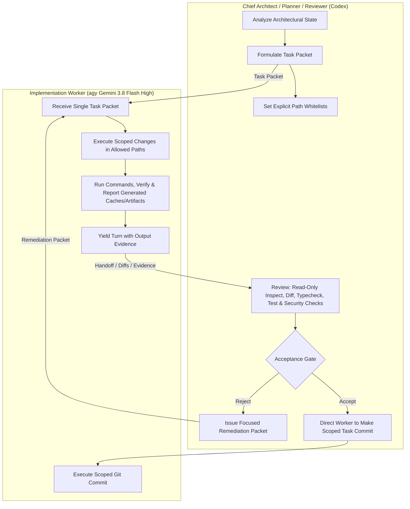
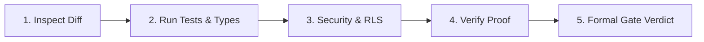

# Planner-Worker Harness Protocol

> **Specification & Operating Standard**  
> **Canonical Workspace:** `C:\Users\HP\Mohammed\CRM`  
> **Status:** Active Standard — Strict Adherence Enforced  

---

## 1. Roles and Hard Boundaries

This engineering workflow is structured as a decoupled **Planner-Worker Harness** to guarantee architectural integrity, prevent regression, and enforce verifiable change control across the CRM codebase.



### 1.1 Role Definitions

*   **Codex — Chief Architect / Planner / Reviewer**
    *   **Responsibilities:** System architecture, phased decomposition, schema evolution, interface definition, RLS policy audit, task packet authoring, gate verification, and final acceptance.
    *   **Inspection Authority:** Codex is fully authorized to execute read-only inspection, git diff analysis, typecheck, test execution, and security-verification commands to independently validate assertions during review.
    *   **Hard Boundary:** **Codex NEVER writes production code, tests, or application configuration files directly, and does NOT execute git commits.** On acceptance, Codex directs the worker to execute a scoped task commit when required by the packet.
*   **agy (Gemini 3.8 Flash High) — Sole Implementation Worker**
    *   **Responsibilities:** Mechanical implementation of exactly one bounded task packet per turn, executing scoped edits, running local test commands, reporting any created caches/artifacts, executing scoped task commits when directed by the Planner, and producing deterministic diffs.
    *   **Hard Boundary:** **agy NEVER expands scope, redesigns interfaces, touches prohibited files, or delegates to subagents.** agy implements only what is explicitly whitelisted in the active task packet.
*   **Supervisor / Lead Architect (User)**
    *   **Responsibilities:** Ultimate approval authority for live infrastructure cutovers, secrets provisioning, external Lovable sync decisions, git reverts, and boundary dispute escalations.

### 1.2 Hard Boundaries Matrix

| Action / Capability | Codex (Planner) | agy (Worker) | Supervisor (User) |
| :--- | :---: | :---: | :---: |
| Author Architecture Plans & Roadmaps | **YES** | NO | Approves |
| Author Scoped Task Packets | **YES** | NO | Reviews |
| Run Read-Only Inspection, Diff, Typecheck, Test & Security Checks | **YES (Review only)** | **YES (Verification)** | Optional |
| Modify Production Code (`.ts`, `.tsx`, `.sql`, `.css`) | **PROHIBITED** | **YES (Whitelisted Only)** | Escalation only |
| Modify Configuration (`package.json`, `tsconfig.json`) | **PROHIBITED** | **YES (Whitelisted Only)** | Escalation only |
| Execute Shell / Build / Test Commands | **YES (Review only)** | **YES** | Optional |
| Execute Scoped Git Commit | **PROHIBITED** | **YES (When Directed on ACCEPT)** | Discretionary |
| Expand Scope Beyond Task Packet | **PROHIBITED** | **PROHIBITED** | Discretionary |
| Launch Internal Subagents | NO | **PROHIBITED by default** | Discretionary |
| Overwrite Target UI with Legacy Components | **PROHIBITED** | **STRICTLY PROHIBITED** | **STRICTLY PROHIBITED** |
| Modify Frozen Root Lovable Source | **PROHIBITED** | **STRICTLY PROHIBITED** | Discretionary |
| Gate Acceptance / Rejection | **YES** | NO | Final Authority |

---

## 2. Standard Task Packet Template

Every implementation turn initiated by the Planner MUST supply a fully qualified Task Packet adhering to this format. If any field is missing or ambiguous, the Worker must pause and request clarification.

```markdown
# TASK PACKET: [PACKET-ID] — [Descriptive Title]

## 1. Objective
A single, unambiguous statement of the exact modification to be performed in this turn.

## 2. Evidence & Baseline Context
- Current verified state (git commit hash, file line counts, test results).
- Related files and dependencies.
- Referenced schema, contracts, or interfaces.

## 3. Allowed Paths (Strict Whitelist)
Only the files and directories listed below may be created, modified, or deleted:
- `path/to/whitelisted/file1.ts`
- `path/to/whitelisted/directory/*`

## 4. Prohibited Paths (Strict Blacklist)
The following paths MUST NOT be touched under any circumstance:
- `src/**` (Root Lovable frozen reference)
- `server/**`, `drizzle/**`, `supabase/**` (Root frozen reference)
- `sn-practice-crm/apps/web/src/app.tsx` (Unless specifically designated in Phase 4)
- Any path not explicitly present in "Allowed Paths"

## 5. Non-Goals
Explicit boundaries to prevent accidental scope creep:
- Do NOT refactor adjacent modules.
- Do NOT introduce unrequested dependencies.
- Do NOT alter runtime persistence wiring outside the specified slice.

## 6. Acceptance Checks
Deterministic criteria that must pass before yielding the turn:
1. Criteria 1 (e.g., Command X exits with code 0).
2. Criteria 2 (e.g., Output contains "XX passed").
3. Criteria 3 (e.g., Export Y conforms to Type Z with zero TypeScript errors).

## 7. Verification Commands & Artifact Reporting
Exact commands the worker must run and report, including audit of any caches or artifacts generated:
- `npm --prefix sn-practice-crm run typecheck`
- `npm --prefix sn-practice-crm test -- path/to/test.ts`
- Audit and report any newly generated cache files (e.g., `.vitest`, `node_modules/.cache`).

## 8. Rollback Notes
Rollback must preserve all unrelated work. Never use blanket commands such as `git checkout -- .`.
- Rollback mechanism: Worker-authored inverse patch or explicit `git revert` of the task commit (only after supervisor approval).
```

---

## 3. Read-Only Audit Settings vs. Implementation Settings

To avoid unintended file changes, the harness distinguishes between two operating modes:

### 3.1 Read-Only Audit & Review Mode
*   **Trigger:** Exploration, baseline validation, dependency analysis, static RLS auditing, diff inspection, and planner review.
*   **Permitted Operations:**
    *   File reads.
    *   Read-only inspection commands (`git status`, `git diff`, directory listings).
    *   Test runners and typecheckers (`npm test`, `vitest run`, `npm run typecheck`) executed for verification.
*   **Side-Effect Awareness:** Test and compilation commands may generate cache directories or runtime artifacts (e.g., `.vitest`, `node_modules/.cache`, build logs). The worker and reviewer must explicitly verify `git status` after execution and report all newly created artifacts.
*   **Strict Restrictions:** No edits, deletions, or package installations.

### 3.2 Implementation Mode
*   **Trigger:** Execution of an approved Task Packet.
*   **Permitted Operations:**
    *   Scoped file writes constrained strictly to **Allowed Paths**.
    *   Scoped dependency installation if mandated by the packet.
    *   Execution of specified verification commands.
*   **Unintended Dirty State Protocol:** If untracked or modified files appear outside Allowed Paths:
    *   **DO NOT discard or run blanket reset commands** (e.g., `git checkout -- .` or `git clean -fd`).
    *   **STOP immediately.**
    *   Preserve all user or peer-agent changes.
    *   Report the exact paths in the status output.
    *   Request an explicit remediation decision from the supervisor.

---

## 4. Execution Protocol & Operational Rules

### 4.1 One Bounded Concern Per Turn
*   Each worker turn handles exactly one isolated concern (e.g., "Import database migrations and run static policy test", NOT "Import database, contracts, API, and rewrite frontend").
*   Turn execution must complete within a single interaction cycle.

### 4.2 Subagent Prohibition
*   The implementation worker **MUST NOT invoke internal subagents** unless the task packet contains an explicit, overriding directive.
*   All operations run directly in the primary execution context to maintain transparency, serial determinism, and prevent uncoordinated file mutations.

### 4.3 Conversation ID Continuity
*   The worker maintains state and conversation thread continuity across turns using the active session/conversation identifier.
*   State handoffs rely on committed git history and written task packets, not transient ephemeral prompts.

### 4.4 Non-Blocking Command Execution & Asynchronous Safety
*   Long-running tasks must specify appropriate execution wait times (`WaitMsBeforeAsync`).
*   The worker must never initiate arbitrary shell sleep loops (`Start-Sleep` or `sleep`).
*   Rely on native command completion signals and asynchronous notifications.

### 4.5 Context Window & Token Efficiency
*   Avoid massive full-file reads or screen dumps when localized ranges suffice.
*   Use targeted inspection tools (`git diff --stat`, line-specific reads).
*   Avoid printing multi-thousand-line files (e.g., `app.tsx`) to logs.

---

## 5. Supervisor Acceptance Gate

Before accepting a completed task packet and declaring a turn successful, the Planner/Reviewer executes the following five-point gate:



1.  **Inspect Diff (`git diff`):**
    *   Verify that `git status` shows modifications **only** in `Allowed Paths`.
    *   Confirm no dirty state outside Allowed Paths. If unexpected files are present, halt and request a supervisor remediation decision.
    *   Verify no formatting drift, unintended whitespace churn, or deletion of unrelated comments.
2.  **Run Scoped Tests & Typecheck:**
    *   Reviewer independently runs or verifies `npm run typecheck` and relevant scoped tests.
    *   Verify exit code 0 and zero regressions against baseline test counts.
    *   Audit and account for any cache files created during testing.
3.  **Check Permissions, Schema & Data Boundaries:**
    *   Verify adherence to [AGENTS.md](../AGENTS.md) and database schema invariants:
        *   Distinguish stored enum values in `public.app_role` (`founder`, `manager`, `senior_staff`, `staff`, `trainee`) from UI display labels (`Founder`, `Manager`, `Senior Staff`, `Staff`, `Trainee`). Stored roles reside strictly in `public.user_roles`, never on profiles.
        *   Verified security-definer helper functions in migration are: `role_of`, `is_active_employee`, `is_founder`, `is_management`, `assignment_involvement`, and `client_visible`. Policies must utilize the appropriate helper for their specific domain without implying that every policy invokes all helpers.
        *   DB triggers and sequences generate auto-codes; the UI never invents them. Assignment codes must match the prefix `AS-` with a 6-digit zero-padded number matching regex `^AS-\d{6}$` (starting at `AS-001001` via `assignment_code_seq`).
        *   Distinguish invoice totals (computed by the `invoice-items` trigger) from invoice `amount_received` and invoice `status` (recomputed exclusively by `payment_allocations` triggers); never write directly to computed columns.
        *   Demo rows carry `is_demo = true`.
4.  **Reject Unsupported Claims:**
    *   Any claim of "tests passing", "clean build", or "schema migrated" must be backed by raw command output in the execution transcript.
    *   Unverified assertions result in immediate turn rejection.
5.  **Formal Verdict:**
    *   **ACCEPT:** Direct the worker to make a scoped task commit (e.g., `git commit -m "task(scope): description"`), record progress, and issue subsequent task packet.
    *   **REJECT:** Issue a remediation packet detailing exact failure logs. Reversion of task changes, if necessary, must use an inverse patch or an explicit `git revert` approved by the supervisor.

---

## 6. Escalation Rules and Completion Definitions

### 6.1 Escalation Triggers
The Worker must immediately halt execution and escalate to the Planner when:
1.  **Path Collision:** Fulfilling the objective requires modifying a file in `Prohibited Paths`.
2.  **Unexpected Dirty State:** Files outside Allowed Paths have uncommitted modifications.
3.  **Contract Incompatibility:** Target domain model conflicts fundamentally with legacy database schema.
4.  **Dependency Breakage:** Monorepo packages fail to compile due to missing peer dependencies.
5.  **Tooling or Prerequisite Absence:** Required external tools (e.g., Supabase CLI, Docker, psql) are unavailable on the host.
6.  **Test Count Discrepancy:** Baseline test suite drops below verified baselines (24 target domain tests, 42 API tests across `application.test.ts` and `http.test.ts`, 9 static DB tests).

### 6.2 Turn Completion Definition
A worker turn is formally complete when and only when:
*   All acceptance checks in the Task Packet evaluate to TRUE.
*   Typecheck passes with zero errors.
*   Tests in the modified scope pass.
*   Diff is strictly confined to `Allowed Paths`.
*   Any newly generated cache files/artifacts are identified and reported.
*   On ACCEPT verdict, the worker executes the scoped git commit if required by the packet.
*   A concise completion report is delivered containing exact command outputs, modified file paths, and git status.

### 6.3 Phase Completion Definition
A reconciliation phase is complete when:
*   All constituent task packets are accepted and committed.
*   Phase-level acceptance gate criteria (defined in [RECONCILIATION_PLAN.md](RECONCILIATION_PLAN.md)) are satisfied.
*   The supervisor records sign-off and authorizes entry into the subsequent phase.
