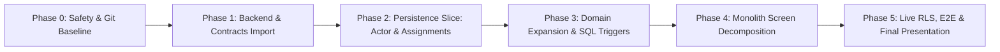
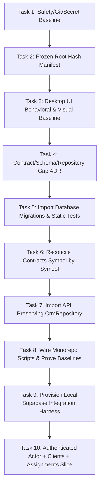

# SN Practice CRM Reconciliation Plan

> **Architectural Master Plan & Phased Execution Roadmap**  
> **Canonical Workspace:** `C:\Users\HP\Mohammed\CRM`  
> **Target Application:** `sn-practice-crm`  
> **Status:** Active Reference Architecture  
> **Viewport Scope:** Desktop-only (1280px+ target viewport)  

---

## 1. Architecture Decision

The canonical target application is **`sn-practice-crm`** (`C:\Users\HP\Mohammed\CRM\sn-practice-crm`). It holds the latest product UX, business workflows, visual hierarchy, and domain logic for SN Practice CRM.

We adopt a **controlled, phased reconciliation strategy**:
1. **Target Desktop UI Preservation:** The clean-slate desktop UX in `sn-practice-crm/apps/web` represents the desired product state. Under no circumstances will it be overwritten or replaced with the older legacy frontend workspaces.
2. **Selective Backend & Migration Import:** We will selectively extract the backend architecture from the legacy workspace (`C:\Users\HP\CRM\Workspace\sn-practice-crm`)—specifically database migration `database/migrations/0001_practice_core.sql`, post-migration catalog test `001_catalog_invariants.sql`, static policy tests `static-policy.test.mjs`, HTTP API handlers in `apps/api`, and non-conflicting types—into `sn-practice-crm`.
3. **Preserve & Deepen Existing `CrmRepository` Interface:** The interface `CrmRepository` is already defined in `apps/api/src/repository.ts`. We will preserve and deepen this interface rather than creating a duplicate in contracts. Any future interface relocation requires an explicit Architecture Decision Record (ADR).
4. **Symbol-by-Symbol Contract Reconciliation:** Because `packages/contracts/src/index.ts` exists in both trees and differs, contracts will not be blindly copied. They will be reconciled symbol-by-symbol, preserving target-only and newer contracts, documented in a contract-diff ADR artifact.
5. **Production Supabase/PostgreSQL Repository:** In legacy, `apps/api/src/index.ts` instantiated `InMemoryCrmRepository`; SQL persistence was never connected. We will implement `SupabaseCrmRepository` executing normal user-scoped queries with the end user's JWT so PostgreSQL RLS evaluates `auth.uid()`. Service-role access is strictly isolated to scheduled background tasks and vetted administrative operations, never exposed to browser code.
6. **Separate Backend Architecture Retained:** The separate backend server architecture (`apps/api`) is retained to handle business operations, authentication verification, and API routing.
7. **Stepwise Monolith Screen Decomposition:** The monolithic frontend in `sn-practice-crm` (`app.tsx` 5,639 lines, `data.ts` 1,002 lines, `styles.css` 2,742 lines) will be decomposed screen-by-screen while locking visual and workflow parity.
8. **Frozen Root Lovable Reference:** The root Lovable/TanStack application (`/src`, `/server`, `/drizzle`, `/supabase`) is byte-identical to the prior workspace and remains completely **frozen** as a historical reference until an explicit retirement decision is made.
9. **Strict Anti-Regression Rule:** **Blind directory copying and big-bang rewrites are strictly prohibited.** Every imported file must be vetted, wired, and verified with automated test baselines.

---

## 2. Facts vs. Inferences Separation

```mermaid
flowchart TD
    subgraph Facts["Supervisor-Verified Facts"]
        F1["Canonical Workspace: C:\Users\HP\Mohammed\CRM"]
        F2["Root Lovable source byte-identical (src 98, server 11, drizzle 7, supabase 2) -> Frozen"]
        F3["sn-practice-crm active product app (app.tsx 5639 lines, data.ts 1002 lines; 24 tests pass)"]
        F4["Legacy: 112 Vitest tests across 4 files; API has 42 tests across application.test.ts and http.test.ts"]
        F5["Legacy API runtime instantiates InMemoryCrmRepository (no SQL wiring)"]
        F6["apps/api/src/repository.ts already defines CrmRepository"]
        F7["packages/contracts/src/index.ts exists in both trees and differs"]
        F8["No Git repository currently exists at either CRM root"]
        F9["001_catalog_invariants.sql present on disk but NOT yet executed on live DB"]
        F10["Exact Stored Roles: founder, manager, senior_staff, staff, trainee (Desktop-only scope)"]
        F11["DB sequence generates AS- codes with AS- plus 6 digits (starting at AS-001001)"]
    end

    subgraph Inferences["Engineering Inferences"]
        I1["Contracts must be reconciled symbol-by-symbol via an ADR artifact"]
        I2["Existing CrmRepository in apps/api must be preserved and implemented with Supabase adapter"]
        I3["End-user JWT must propagate to Supabase repository for auth.uid() RLS evaluation"]
        I4["Local Supabase integration harness requires official Supabase CLI + Docker/psql"]
    end

    F7 --> I1
    F6 --> I2
    F5 --> I3
    F9 --> I4
```

### 2.1 Supervisor-Verified Facts
1. **Authoritative Root:** Canonical workspace is `C:\Users\HP\Mohammed\CRM`.
2. **Frozen Root Source:** Root directories (`/src` [98 files], `/server` [11 files], `/drizzle` [7 files], `/supabase` [2 files]) are byte-identical to the predecessor workspace. They are frozen and must not be modified.
3. **Active Target Application:** `sn-practice-crm` is the clean-slate product application holding the newest product UX and domain workflows. It operates on an in-memory frontend store (`app.tsx` [5,639 lines], `data.ts` [1,002 lines], `styles.css` [2,742 lines]). Monorepo typecheck passes and its 24 domain tests pass.
4. **Verified Test Counts:**
   * Target application has **24 passing tests** in `packages/domain/src/authority.test.ts`.
   * Legacy monorepo has **112 total Vitest tests** across 4 files:
     * Legacy `apps/api`: **42 tests across 2 files (`application.test.ts` and `http.test.ts`)**.
     * Legacy `apps/web`: **46 tests** in `dashboard-live.test.tsx`.
     * Legacy `packages/domain`: **24 tests** in `authority.test.ts`.
   * Legacy database package has **9 static policy tests** in `database/tests/static-policy.test.mjs`.
5. **Legacy Persistence Disconnection:** The legacy API runtime (`apps/api/src/index.ts`) instantiates `InMemoryCrmRepository`. Persistence was never wired to PostgreSQL or Supabase at runtime.
6. **Existing Repository Interface:** `apps/api/src/repository.ts` already defines the `CrmRepository` interface. It is not defined in contracts.
7. **Differing Contracts:** `packages/contracts/src/index.ts` exists in both trees and has diverged (target contains foundational session/envelope types; legacy contains expanded DTOs).
8. **No Git Repository:** Neither workspace root currently contains a `.git` repository.
9. **Post-Migration Catalog Test Status:** `database/tests/001_catalog_invariants.sql` is a real post-migration PostgreSQL catalog test present on disk, but it has **not yet been executed against a live database instance**. The 9 passing tests in `database` are static file checks only.
10. **Role Authority Model:** Distinguish stored enum values from UI labels. Stored enum values in PostgreSQL `public.app_role` are strictly lowercase: `founder`, `manager`, `senior_staff`, `staff`, `trainee`. UI presentation labels are `Founder`, `Manager`, `Senior Staff`, `Staff`, `Trainee`. There is no Finance role. Viewport scope is desktop-only.
11. **Auto-Generated Code Prefix & Sequence:** The database sequence trigger (`assignment_code_seq` starting at 1001) generates assignment codes using `'AS-' || lpad(nextval('public.assignment_code_seq')::text, 6, '0')`. Assignment codes match prefix `AS-` and regex `^AS-\d{6}$` (e.g., initial code `AS-001001`).
12. **Role Allocations:** Codex is Chief Architect/Planner/Reviewer (never writes production code or commits). `agy` (Gemini 3.8 Flash High) is the sole implementation worker.

### 2.2 Inferences & Engineering Implications
1. **Symbol-by-Symbol Reconciliation:** To prevent wiping target-specific types, contract integration must be a non-destructive union and alignment documented in a contract-diff ADR.
2. **JWT Propagation & RLS:** The production `SupabaseCrmRepository` must accept the authenticated user's JWT so that PostgreSQL RLS policies evaluate `auth.uid()` against `public.user_roles`. Service role is restricted to background jobs (recurring task creation) and vetted administrative tasks.
3. **Verified RLS Helper Function Set:** The verified migration security-definer helpers are `role_of`, `is_active_employee`, `is_founder`, `is_management`, `assignment_involvement`, and `client_visible`. RLS policies utilize the relevant helper for their scope without implying that every policy invokes all helpers.
4. **Database Triggers:** Invoice total amounts are calculated by the `invoice-items` trigger. Invoice `amount_received` and invoice `status` are recomputed exclusively by `payment_allocations` triggers. Code must not write directly to computed columns.
5. **Tooling Prerequisites:** Live catalog testing requires the official Supabase CLI and a running Docker daemon. If absent, tasks must pause and report exact prerequisite gaps rather than simulating execution or writing bespoke runners.

---

## 3. Phased Implementation Roadmap

### Phase 0: Safety Baseline, Version Control & Secret Hygiene
*   **Objectives:** Initialize a local Git repository at `C:\Users\HP\Mohammed\CRM` without attaching or pushing to a remote. Audit and augment `.gitignore`. Verify with `git check-ignore` that `.env` and `.env.local` are ignored without exposing contents. Record hash manifest of frozen root directories (`src`, `server`, `drizzle`, `supabase`).
*   **Acceptance Gate:**
    *   `git check-ignore -v .env .env.local` confirms secrets are ignored.
    *   `git status` is clean with initial baseline commit recorded.
    *   Frozen root hash manifest committed.

### Phase 1: Backend, Database & Contracts Import (Zero Wiring, Zero UI Regression)
*   **Objectives:** Selectively import modular infrastructure into `sn-practice-crm`:
    *   Import database migration `0001_practice_core.sql` and static policy test suite.
    *   Reconcile `packages/contracts/src/index.ts` symbol-by-symbol, preserving target types and documenting differences in an ADR artifact.
    *   Import `apps/api` while preserving the existing `CrmRepository` interface in `apps/api/src/repository.ts`.
    *   Wire monorepo test scripts.
*   **Acceptance Gate:**
    *   Target frontend `app.tsx` and `data.ts` remain completely untouched.
    *   Automated test baselines proven: **24 target domain tests + 42 API tests across `application.test.ts` and `http.test.ts` + 9 static DB tests** pass cleanly.
    *   Monorepo typecheck passes across all packages.

### Phase 2: Production Persistence Vertical Slice (Authenticated Actor + Read-Only Clients + Assignments)
*   **Objectives:** Implement the first live SQL persistence slice through the separate backend server (`apps/api`):
    *   Implement Supabase Auth and session propagation forwarding user JWT on API calls.
    *   Resolve actor identity and roles from `public.user_roles` (stored enum `public.app_role`, verifying `auth.uid()`).
    *   Implement read-only client queries required to populate client dropdowns and assignments context.
    *   Implement `SupabaseCrmRepository` for assignments CRUD adhering to `CrmRepository` in `apps/api/src/repository.ts`.
    *   Validate that assignment codes are generated by the DB sequence matching prefix `AS-` and regex `^AS-\d{6}$` (starting at `AS-001001`).
*   **Acceptance Gate:**
    *   Actor resolution correctly reads lowercase enum values from `public.user_roles`, never `profiles`.
    *   User JWT forwards to Supabase so PostgreSQL RLS evaluates `auth.uid()`.
    *   Assignment creation roundtrip verified; auto-code format matches `^AS-\d{6}$`.
    *   Separate backend server runtime runs the slice cleanly without regression.

### Phase 3: Core Domain Expansion & SQL Trigger Alignment
*   **Objectives:** Expand `SupabaseCrmRepository` and database schema across all CRM domains:
    *   Recurring Schedules & generation engine (service-role background trigger).
    *   Work Items (delegated, internal, personal) and reporting hierarchy (`reportsToId`).
    *   Office Accounts (cash/bank ledgers, inflows, outflows).
    *   Invoicing and Billing: Ensure invoice totals are derived via `invoice-items` triggers, and invoice `amount_received` and invoice `status` are recomputed exclusively by `payment_allocations` triggers.
    *   Tag all demo rows with `is_demo = true`.
*   **Acceptance Gate:**
    *   Full domain repository test coverage.
    *   Trigger-based balance and status computation verified.
    *   Demo data isolation verified.

### Phase 4: Target Desktop Monolith Screen-by-Screen Decomposition
*   **Objectives:** Decompose `sn-practice-crm/apps/web/src/app.tsx` (5,639 lines) and `data.ts` (1,002 lines) into modular screen workspaces, shared components, and query hooks for the desktop viewport (1280px+).
*   **Decomposition Order:**
    1.  *Shell & Global State:* Navigation sidebar, header, role switcher (`Founder`, `Manager`, `Senior Staff`, `Staff`, `Trainee` mapped to `public.app_role`), authenticated user context.
    2.  *Dashboard Workspace:* Executive metrics, task counters, urgency daybook.
    3.  *Clients Workspace:* Client 360, contact directories, group hierarchies.
    4.  *Assignments & Tasks Workspace:* Kanban, table view, assignment detail slide-over.
    5.  *Work Items & Schedules:* Personal task manager, recurrence scheduler.
    6.  *Billing & Collections:* Invoices, payment allocation modals, receipt generator.
    7.  *Office Accounts & Cashflow:* Ledger entries, category breakdowns.
    8.  *Settings & Administration:* Team rosters, role management, demo data purge.
*   **Acceptance Gate:**
    *   `app.tsx` reduced to a clean routing shell (< 300 lines).
    *   Visual regression baseline verified; zero styling or desktop layout regression.
    *   UI connects to application data hooks backed by API.

### Phase 5: Live RLS Catalog Verification, E2E, Observability & Final Presentation
*   **Objectives:** Validate security across live database catalog, run multi-role E2E suite, configure observability, and deliver the final presentation.
*   **Key Deliverables:**
    *   Execute `database/tests/001_catalog_invariants.sql` against a live Supabase/PostgreSQL instance.
    *   Playwright desktop E2E test suite covering all five roles: **Founder**, **Manager**, **Senior Staff**, **Staff**, **Trainee**.
    *   Observability, structured audit logging, and runbook documentation.
    *   **Final Feature/Function Presentation:** Deliver a comprehensive showcase and presentation walkthrough of the completed system as requested by the user.
*   **Acceptance Gate:**
    *   100% pass on live PostgreSQL catalog invariant tests.
    *   100% pass on desktop E2E tests across all five roles.
    *   Final feature/function presentation accepted by Supervisor.

---

## 4. First 10 Small Ordered Worker Tasks

Below are the initial 10 atomic, sequential tasks for the implementation worker (`agy`). Each task handles exactly one bounded concern.

---

### Task 1: Safety, Version Control & Secret Hygiene Baseline
*   **Objective:** Audit and augment the workspace `.gitignore`. Verify that `.env` and `.env.local` are ignored using `git check-ignore` without printing their contents. Initialize a local Git repository at `C:\Users\HP\Mohammed\CRM` without attaching or pushing to a remote, and create the baseline commit.
*   **Allowed Paths:**
    *   `.gitignore`
    *   `docs/PLANNER_WORKER_PROTOCOL.md`
    *   `docs/RECONCILIATION_PLAN.md`
*   **Prohibited Paths:** All files in `src/**`, `server/**`, `drizzle/**`, `supabase/**`, `sn-practice-crm/**`.
*   **Acceptance Checks:**
    1.  `git check-ignore -v .env .env.local` confirms both patterns match `.gitignore`.
    2.  No secret contents are echoed in command outputs or committed.
    3.  `git remote` returns empty (no remote attached).
    4.  Initial commit created cleanly.
*   **Verification Command:** `git check-ignore -v .env .env.local; git status; git log -1 --oneline`.

---

### Task 2: Frozen Root Hash Manifest
*   **Objective:** Compute and document SHA-256 hashes of all files in root frozen directories (`src`, `server`, `drizzle`, `supabase`) to establish an unalterable integrity baseline.
*   **Allowed Paths:**
    *   `docs/FROZEN_ROOT_MANIFEST.md`
*   **Prohibited Paths:** Any modification to `src/**`, `server/**`, `drizzle/**`, `supabase/**`.
*   **Acceptance Checks:**
    1.  Manifest documents file count (src 98, server 11, drizzle 7, supabase 2 = 118 files total).
    2.  `git status` confirms zero modifications in root source folders.
*   **Verification Command:** `git status -- src server drizzle supabase`.

---

### Task 3: Desktop UI Behavioral & Visual Baseline Before Integration
*   **Objective:** Document the current desktop UX state, role switcher options (UI labels: `Founder`, `Manager`, `Senior Staff`, `Staff`, `Trainee`), and view workflows in `sn-practice-crm/apps/web/src/app.tsx` (5,639 lines) into a baseline artifact before any integration work begins.
*   **Allowed Paths:**
    *   `docs/DESKTOP_UI_BASELINE.md`
*   **Prohibited Paths:**
    *   `sn-practice-crm/apps/web/src/**`
    *   Root source directories.
*   **Acceptance Checks:**
    1.  `docs/DESKTOP_UI_BASELINE.md` maps every existing view and role permission in the target UI.
    2.  `npm --prefix sn-practice-crm test` passes (24 domain tests).
*   **Verification Command:** `npm --prefix sn-practice-crm test`.

---

### Task 4: Contract, Schema & Repository Gap ADR
*   **Objective:** Conduct a read-only comparison between target `data.ts` / `authority.ts` versus legacy `packages/contracts`, `0001_practice_core.sql`, and `apps/api/src/repository.ts`. Formulate an Architecture Decision Record (ADR) detailing symbol reconciliation, trigger behaviors, and repository interfaces.
*   **Allowed Paths:**
    *   `docs/adr/0001-contract-schema-reconciliation.md`
*   **Prohibited Paths:** All production code and schemas.
*   **Acceptance Checks:**
    1.  ADR documents exact diff between `sn-practice-crm/packages/contracts/src/index.ts` and legacy contracts.
    2.  Confirms assignment code format prefix is `AS-` and regex is `^AS-\d{6}$` (starting at `AS-001001`) via sequence trigger `assignment_code_seq`.
    3.  Confirms `CrmRepository` interface remains in `apps/api/src/repository.ts`.
    4.  No production files modified.
*   **Verification Command:** `git status`.

---

### Task 5: Import Database Migrations & Static Policy Tests
*   **Objective:** Selectively import `0001_practice_core.sql`, `001_catalog_invariants.sql`, and `static-policy.test.mjs` from legacy into `sn-practice-crm/database`. Clarify that catalog tests are post-migration tests that are not yet executed against a live database.
*   **Allowed Paths:**
    *   `sn-practice-crm/database/**`
*   **Prohibited Paths:**
    *   `sn-practice-crm/apps/**`
    *   Root directories.
*   **Acceptance Checks:**
    1.  Files imported: `database/migrations/0001_practice_core.sql`, `database/tests/001_catalog_invariants.sql`, and `database/tests/static-policy.test.mjs`.
    2.  Static policy test passes: 9 static policy checks pass.
    3.  Explicit notice recorded in task output: `001_catalog_invariants.sql` is present on disk but not yet executed against a live database.
*   **Verification Command:** `node sn-practice-crm/database/tests/static-policy.test.mjs`.

---

### Task 6: Reconcile Contracts Symbol-by-Symbol
*   **Objective:** Reconcile `packages/contracts/src/index.ts` symbol-by-symbol by merging non-conflicting types from legacy while strictly preserving existing target types (`SessionActor`, `ApiEnvelope`, `ApiProblem`).
*   **Allowed Paths:**
    *   `sn-practice-crm/packages/contracts/src/index.ts`
*   **Prohibited Paths:**
    *   `sn-practice-crm/apps/web/src/**`
    *   `sn-practice-crm/packages/domain/**`
*   **Acceptance Checks:**
    1.  Target types (`SessionActor`, `ApiEnvelope`, `ApiProblem`) remain unchanged.
    2.  Legacy DTOs (`AssignmentDto`, `WorkItemDto`, `RecurringScheduleDto`, `LedgerEntryDto`) are integrated.
    3.  `npm --prefix sn-practice-crm run typecheck` passes across `packages/contracts`.
    4.  Target domain tests (24 tests) remain green.
*   **Verification Command:** `npm --prefix sn-practice-crm test`.

---

### Task 7: Import API Application Preserving Existing Repository Interface
*   **Objective:** Import `apps/api` from legacy into `sn-practice-crm/apps/api`. Preserve the existing `CrmRepository` interface in `apps/api/src/repository.ts` and ensure its 42 Vitest tests across `application.test.ts` and `http.test.ts` pass without touching frontend code.
*   **Allowed Paths:**
    *   `sn-practice-crm/apps/api/**`
*   **Prohibited Paths:**
    *   `sn-practice-crm/apps/web/**`
    *   `sn-practice-crm/packages/contracts/src/repository.ts` (Duplicate creation prohibited)
*   **Acceptance Checks:**
    1.  `apps/api/src/repository.ts` defines `CrmRepository` matching legacy contract.
    2.  `npm --prefix sn-practice-crm/apps/api test` executes and passes all **42 tests across 2 files (`application.test.ts` and `http.test.ts`)**.
    3.  No changes to `sn-practice-crm/apps/web`.
*   **Verification Command:** `npm --prefix sn-practice-crm/apps/api test`.

---

### Task 8: Wire Monorepo Scripts & Prove Verified Baselines
*   **Objective:** Configure top-level workspace scripts in `sn-practice-crm/package.json` to run typechecking and tests across all imported packages. Prove the verified baseline: 24 target tests + 42 API tests across `application.test.ts` and `http.test.ts` + 9 static DB tests.
*   **Allowed Paths:**
    *   `sn-practice-crm/package.json`
*   **Prohibited Paths:** All source code in `apps/**` and `packages/**`.
*   **Acceptance Checks:**
    1.  `npm --prefix sn-practice-crm run test:all` executes all sub-packages.
    2.  Exact counts verified: 24 domain tests pass, 42 API tests pass across `application.test.ts` and `http.test.ts`, 9 static DB tests pass.
    3.  Typecheck passes cleanly across the entire monorepo.
*   **Verification Command:** `npm --prefix sn-practice-crm run test:all; npm --prefix sn-practice-crm run typecheck`.

---

### Task 9: Provision Official Local Supabase Integration Harness
*   **Objective:** Check host prerequisites using direct official commands (`Get-Command supabase`, `docker version`, `psql --version`). If tools are available, start local Supabase, apply `0001_practice_core.sql` via `supabase db reset`, and execute `001_catalog_invariants.sql` with `psql`. If tools are unavailable, stop and report exact prerequisites in `docs/LOCAL_SUPABASE_SETUP.md`; do not create bespoke runners to simulate readiness.
*   **Allowed Paths:**
    *   `sn-practice-crm/database/package.json`
    *   `docs/LOCAL_SUPABASE_SETUP.md`
*   **Prohibited Paths:**
    *   `sn-practice-crm/database/migrations/**`
    *   Any bespoke script simulating runner status.
*   **Acceptance Checks:**
    1.  Official commands (`Get-Command supabase`, `docker version`, `psql --version`) determine environment readiness.
    2.  If available: `supabase db reset` applies migration and `psql` passes `001_catalog_invariants.sql` against live PostgreSQL.
    3.  If unavailable: task halts cleanly, reports missing tooling, and details exact installation instructions in `docs/LOCAL_SUPABASE_SETUP.md`.
*   **Verification Command:** `Get-Command supabase; docker version; psql --version`. (When available: `supabase db reset; psql -f sn-practice-crm/database/tests/001_catalog_invariants.sql`).

---

### Task 10: Authenticated Actor + Read-Only Clients + Assignments Supabase Slice
*   **Objective:** Implement the initial `SupabaseCrmRepository` slice implementing `CrmRepository` for Authenticated Actor resolution (verifying lowercase stored enum values in `public.app_role`), read-only client queries, and Assignments CRUD. Forward user JWT on queries so PostgreSQL RLS evaluates `auth.uid()`. Retain separate backend server.
*   **Allowed Paths:**
    *   `sn-practice-crm/apps/api/src/supabase-repository.ts`
    *   `sn-practice-crm/apps/api/src/supabase-repository.test.ts`
    *   `sn-practice-crm/apps/api/src/repository.ts`
*   **Prohibited Paths:**
    *   `sn-practice-crm/apps/web/src/app.tsx`
*   **Acceptance Checks:**
    1.  Actor role resolution queries `public.user_roles` and verifies the stored lowercase enum values in `public.app_role` (`founder`, `manager`, `senior_staff`, `staff`, `trainee`).
    2.  Queries forward user JWT for RLS `auth.uid()` evaluation.
    3.  Read-only client listing enables assignment association.
    4.  Assignment creation relies on DB sequence trigger for `AS-` codes matching regex `^AS-\d{6}$` (e.g., initial sequence code `AS-001001`).
    5.  Unit/mock tests for the Supabase repository slice pass with 100% assertions.
*   **Verification Command:** `npm --prefix sn-practice-crm/apps/api test -- supabase-repository.test.ts`.

---

## 5. Architectural Guardrails & Invariants

1.  **Desktop Viewport Focus:** All frontend features and screen decompositions are targeted strictly to desktop viewports (1280px+). Responsive/mobile redesigns are non-goals.
2.  **Anti-Regression Mandate:**
    *   The target UI in `sn-practice-crm/apps/web/src/app.tsx` must never be overwritten by legacy components.
    *   All visual design tokens (`src/styles.css` navy `--primary`, red accent `--signal`) must remain untouched until screen-by-screen modular extraction in Phase 4.
3.  **Strict No-Blind-Copy Rule:** Files must not be copied en masse from `C:\Users\HP\CRM\Workspace\sn-practice-crm`. Every file must be imported under a dedicated task packet and verified with automated test suites.
4.  **Database & RLS Compliance:**
    *   Stored roles reside strictly in `public.user_roles` as lowercase enum values in `public.app_role` (`founder`, `manager`, `senior_staff`, `staff`, `trainee`). UI labels are `Founder`, `Manager`, `Senior Staff`, `Staff`, `Trainee`. Roles never reside on profiles.
    *   Verified migration security-definer helper functions are: `role_of`, `is_active_employee`, `is_founder`, `is_management`, `assignment_involvement`, and `client_visible`. Policies invoke the relevant helper for their domain without implying that every policy invokes all helpers.
    *   Assignment codes are generated via `assignment_code_seq` starting at 1001 with prefix `AS-` and regex `^AS-\d{6}$` (e.g., `AS-001001`).
    *   Invoice totals are computed by the `invoice-items` trigger. Invoice `amount_received` and invoice `status` are recomputed exclusively by `payment_allocations` triggers.
    *   Demo data must carry `is_demo = true`.
5.  **Database Catalog Status Notice:**
    *   Static analysis of SQL files is complete (`database/tests/static-policy.test.mjs` passes 9 checks).
    *   `001_catalog_invariants.sql` is a real post-migration test present on disk, but has **not yet been executed against a live database instance**.
