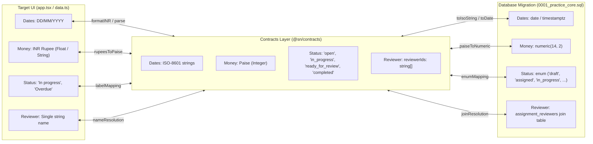
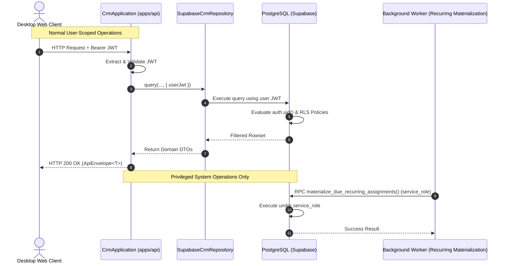
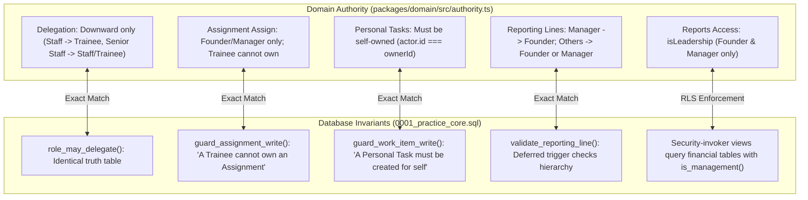
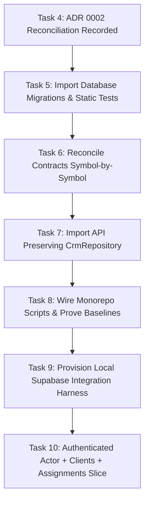

# ADR 0002: Contract, Schema, RLS, and Repository Reconciliation

- **Status:** Proposed
- **Date:** 2026-10-31
- **Deciders:** Supervisor (User) + Chief Architect (Codex)
- **Scope Boundary:** Canonical target monorepo (`sn-practice-crm`), Contracts, Domain Authority, API Repository Architecture, PostgreSQL Database Schema, and Row Level Security
- **Supersession Relationship:** Extends and refines [0001-clean-slate-crm-boundary.md](file:///C:/Users/HP/Mohammed/CRM/docs/adr/0001-clean-slate-crm-boundary.md). This ADR does not replace ADR 0001; it formalizes the contract, schema, and interface reconciliation mechanics required before any backend or migration code is imported.

---

## 1. Context and Evidence Inventory

### 1.1 Architectural Baseline and Invariant Principles

The production CRM is being constructed beside the frozen Lovable reference code under `sn-practice-crm/` pursuant to ADR 0001. The target desktop user interface located in `sn-practice-crm/apps/web/src/app.tsx` (5,876 lines), `data.ts` (1,028 lines), and `styles.css` (3,187 lines) represents the approved product design, visual hierarchy, and desktop workflow baseline (documented in [DESKTOP_UI_BASELINE.md](file:///C:/Users/HP/Mohammed/CRM/docs/DESKTOP_UI_BASELINE.md)).

Under no circumstances will the legacy frontend (`C:\Users\HP\CRM\Workspace\sn-practice-crm\apps\web`) be imported or merged into the target. Reconciliation is strictly confined to:
1. Reconciling shared type definitions in `packages/contracts/src/index.ts`.
2. Preserving the domain authority engine in `packages/domain/src/authority.ts`.
3. Importing the backend API server from `apps/api` while preserving the existing repository abstraction `CrmRepository` in `apps/api/src/repository.ts`.
4. Importing the database migration `0001_practice_core.sql` and static policy test suite from `database/`.
5. Designing the production persistence adapter `SupabaseCrmRepository` to execute under the authenticated user's JWT with Row Level Security (RLS) enforcement.

### 1.2 Evidence Sources Inspected

#### Canonical Target Workspace (`C:\Users\HP\Mohammed\CRM\sn-practice-crm`)
- `packages/contracts/src/index.ts`: 19 lines, 3 exported interfaces (`SessionActor`, `ApiEnvelope<T>`, `ApiProblem`).
- `packages/domain/src/authority.ts`: 163 lines, pure domain authority rules (`authorize`, `validateReportingLine`, `COMPANY_ROLES`).
- `packages/domain/src/authority.test.ts`: 119 lines, 24 unit tests covering practice authority, delegation boundaries, personal tasks, and reporting lines.
- `apps/web/src/data.ts`: 1,028 lines, in-memory mock fixtures (`ASSIGNMENTS`, `CLIENTS`, `RECURRING_SCHEDULES`, `INVOICES`, `RECEIPTS`, `PERSONAL_TASKS`, `DELEGATED_TASKS`), UI presentation types, and formatting helpers.
- `apps/web/src/app.tsx`: 5,876 lines, single-page desktop application shell and navigation for 10 top-level views.
- `apps/api/src/repository.ts`: **Does not exist** on disk in the target repository. The `apps/api` directory has not yet been introduced.
- `package.json`: Target monorepo root manifest declaring workspace packages.

#### Legacy Reference Workspace (`C:\Users\HP\CRM\Workspace\sn-practice-crm`, Read-Only)
- `packages/contracts/src/index.ts`: 180 lines, 22 exported symbols covering foundational envelopes, assignments, recurring schedules, work items, reporting lines, and office ledger entries.
- `apps/api/src/repository.ts`: 32 lines, exports `EmployeeRecord` and `CrmRepository` (14 async methods).
- `apps/api/src/application.ts`: 486 lines, implements `CrmApplication` domain orchestration backed by `CrmRepository` and `@sn/domain`.
- `apps/api/src/index.ts`: 33 lines, API server bootstrap; lines 12–13 prove that `InMemoryCrmRepository` with `createDemoSeed()` is instantiated at runtime.
- `apps/api/src/in-memory-repository.ts`: 95 lines, RAM-based implementation of `CrmRepository` storing records in private `Map` instances.
- `database/migrations/0001_practice_core.sql`: 2,960 lines (107,344 bytes), defining 13 custom enum types, 7 code generation sequences, 16 tables, 49 total functions (34 LANGUAGE plpgsql and 15 LANGUAGE sql; 42 SECURITY DEFINER and 7 invoker functions), 43 triggers, 50 RLS policies, and 4 security-invoker views.
- `database/tests/001_catalog_invariants.sql`: 294 lines, post-migration catalog test checking RLS table coverage, SELECT policies, immutability constraints, trigger configurations, and sequence defaults. *(Status: Present on disk / disk-only; NOT yet executed against a live database instance).*
- `database/tests/static-policy.test.mjs`: 211 lines, 9 passing Node.js unit tests performing static AST and regex validation of `0001_practice_core.sql`.

### 1.3 Facts vs. Inferences Separation

| Fact (Supervisor-Verified & Source-Backed) | Engineering Decision / Inference | Deferred Work Boundary |
| :--- | :--- | :--- |
| Target contracts exports exactly 3 symbols (`SessionActor`, `ApiEnvelope`, `ApiProblem`). | Reconcile contracts symbol-by-symbol without modifying or removing the 3 target symbols. | Task CRM-P1-T6 |
| Target monorepo has no `apps/api` directory on disk. | Retain `CrmRepository` in `apps/api/src/repository.ts`; do NOT invent a duplicate interface in `packages/contracts`. | Task CRM-P1-T7 |
| Legacy API runs on `InMemoryCrmRepository`; SQL persistence was never wired. | Design `SupabaseCrmRepository` forwarding user JWT for PostgreSQL RLS `auth.uid()` evaluation. | Task CRM-P2-T10 |
| Stored database roles are strictly lowercase `public.app_role` (`founder`, `manager`, `senior_staff`, `staff`, `trainee`). | Maintain strict translation boundary between DB lowercase enums and UI title-case display labels. | Tasks CRM-P1-T6, T10, Phase 4 |
| Database auto-generates business codes via sequences: `clients` (`CL-`), `schedules` (`RS-`), `assignments` (`AS-`), `work_items` (`WI-`), `ledger` (`LE-`), `invoices` (`INV-`), `receipts` (`RCT-`). | UI must never fabricate business codes; API and UI must consume sequence-generated codes from the database. | Tasks CRM-P1-T6, T7, T10 |
| `001_catalog_invariants.sql` is present on disk but has NOT run on live PostgreSQL. | Acknowledge catalog tests are unverified against a live database; verify only static tests (9 tests) until local harness is provisioned. | Task CRM-P1-T5, T9 |
| Migration `0001_practice_core.sql` defines 16 tables, 50 policies, 49 total functions (34 plpgsql, 15 sql; 42 security-definer, 7 invoker), and 43 triggers. | Map domain models and DTOs directly to verified migration tables and triggers; avoid relying on AGENTS.md prose drift. | Active in this ADR |
| `is_finance_or_manager` helper does NOT exist in SQL migration. | Flag documentation drift; use `is_management(p_user_id)` which checks `role_of(p_user_id) in ('founder', 'manager')`. | Active in this ADR |
| Invoices total amounts are computed by `invoice-items` trigger; received amounts and status are computed by `payment_allocations` triggers. | Disallow direct writes to computed invoice columns in API mutations and contracts. | Active in this ADR, Tasks CRM-P1-T6, Phase 3 |

---

## 2. Symbol-by-Symbol Contracts Comparison

### 2.1 Complete Symbol Inventory and Classification

Every exported symbol from both contract files is enumerated below. No discovered symbol has been omitted.

| Symbol Name | Symbol Kind | Target Status (`sn-practice-crm`) | Legacy Status (`legacy/packages/contracts`) | Classification | Task CRM-P1-T6 Disposition |
| :--- | :--- | :--- | :--- | :--- | :--- |
| `SessionActor` | `interface` | Exported (lines 3–8) | Exported (lines 3–8) | Same-Name Compatible (Identical) | Preserve target definition unchanged. |
| `ApiEnvelope<T>` | `interface` | Exported (lines 10–13) | Exported (lines 10–13) | Same-Name Compatible (Identical) | Preserve target definition unchanged. |
| `ApiProblem` | `interface` | Exported (lines 15–19) | Exported (lines 15–19) | Same-Name Compatible (Identical) | Preserve target definition unchanged. |
| `ApiErrorEnvelope` | `interface` | Not Present | Exported (lines 21–28) | Legacy-Only | Import into target contracts to standardize error envelopes. |
| `AssignmentStatus` | `type` | Not Present | Exported (line 30) | Legacy-Only (Semantic Overlap) | Import into target contracts; establish conversion mapping to SQL `assignment_status` and UI status strings. |
| `AssignmentDto` | `interface` | Not Present | Exported (lines 32–47) | Legacy-Only | Import into target contracts as the baseline assignment transport contract. |
| `CreateAssignmentInput` | `interface` | Not Present | Exported (lines 49–57) | Legacy-Only | Import into target contracts for assignment creation mutations. |
| `AssignmentTransition` | `type` | Not Present | Exported (line 59) | Legacy-Only | Import into target contracts for assignment lifecycle state transitions. |
| `RecurringScheduleDto` | `interface` | Not Present | Exported (lines 61–76) | Legacy-Only | Import into target contracts as the baseline schedule transport contract. |
| `CreateRecurringScheduleInput` | `interface` | Not Present | Exported (lines 78–88) | Legacy-Only | Import into target contracts for schedule creation mutations. |
| `WorkItemKind` | `type` | Not Present | Exported (line 90) | Legacy-Only (Matches SQL) | Import into target contracts; exactly matches SQL `public.work_item_kind`. |
| `WorkItemStatus` | `type` | Not Present | Exported (line 91) | Legacy-Only (Semantic Overlap) | Import into target contracts; establish conversion mapping to SQL `work_item_status`. |
| `WorkItemDto` | `interface` | Not Present | Exported (lines 93–108) | Legacy-Only | Import into target contracts as the baseline work item transport contract. |
| `CreateWorkItemInput` | `type` | Not Present | Exported (lines 110–136) | Legacy-Only | Import into target contracts; discriminated union by `kind`. |
| `WorkItemTransition` | `type` | Not Present | Exported (line 138) | Legacy-Only | Import into target contracts for work item state transitions. |
| `ReportingLineDto` | `interface` | Not Present | Exported (lines 140–143) | Legacy-Only | Import into target contracts for reporting hierarchy queries. |
| `UpdateReportingLineInput` | `interface` | Not Present | Exported (lines 145–147) | Legacy-Only | Import into target contracts for reporting line updates. |
| `LedgerDirection` | `type` | Not Present | Exported (line 149) | Legacy-Only (Semantic Overlap) | Import into target contracts; map `'inflow'`/`'outflow'` to SQL `'receipt'`/`'payment'`. |
| `LedgerAccount` | `type` | Not Present | Exported (line 150) | Legacy-Only (Semantic Overlap) | Import into target contracts; map to SQL `cash_account_kind` and `cash_accounts`. |
| `LedgerEntryDto` | `interface` | Not Present | Exported (lines 152–162) | Legacy-Only | Import into target contracts as office cash ledger transport contract. |
| `CreateLedgerEntryInput` | `interface` | Not Present | Exported (lines 164–171) | Legacy-Only | Import into target contracts for ledger entry recording. |
| `OfficeAccountsSummaryDto` | `interface` | Not Present | Exported (lines 173–180) | Legacy-Only | Import into target contracts for cash/bank balances summary. |

### 2.2 Discrepancy Analysis and Conversion Boundaries



1. **Foundational Types Preserved (`SessionActor`, `ApiEnvelope`, `ApiProblem`):**
   - The 3 symbols currently defined in `sn-practice-crm/packages/contracts/src/index.ts` are byte-compatible and structurally identical to lines 3–19 in legacy contracts.
   - `SessionActor` depends on `CompanyRole` imported from `@sn/domain`. Both target and legacy `@sn/domain` define `COMPANY_ROLES = ['founder', 'manager', 'senior_staff', 'staff', 'trainee'] as const`.
   - These 3 symbols are strictly preserved without alteration.

2. **Monetary Representation:**
   - **Contracts:** Legacy `LedgerEntryDto` and `OfficeAccountsSummaryDto` store monetary values in integer paise (`amountPaise`, `cashBalancePaise`, `bankBalancePaise`).
   - **Database:** `0001_practice_core.sql` uses `numeric(14, 2)` (Rupees) for `cash_ledger_entries.amount`, `invoices.subtotal_amount`, `invoices.tax_amount`, `invoices.total_amount`, `invoices.amount_received`, and `payment_receipts.amount`.
   - **UI:** `data.ts` uses floating-point numbers in Rupees (`InvoiceRecord.subtotal`, `ReceiptRecord.amount`) formatted with `formatINR` in `Asia/Kolkata`.
   - **Boundary Conversion Decision:** The repository layer will translate between PostgreSQL `numeric(14, 2)` and DTO integer paise (`paise = Math.round(Number(numericVal) * 100)`). When Invoices and Receipts DTOs are introduced in Phase 3, they will follow the integer paise convention to prevent floating-point rounding errors across network boundaries.

3. **Date and Time Representations:**
   - **Contracts:** Dates and timestamps are represented as ISO-8601 strings (`dueAt: string`, `occurredOn: string`, `createdAt: string`).
   - **Database:** Mixed `date` (`entry_date`, `issue_date`, `due_date`, `start_date`, `next_occurrence_date`) and `timestamptz` (`due_at`, `created_at`, `updated_at`, `reconciled_at`).
   - **UI:** `data.ts` displays Indian calendar strings (`DD/MM/YYYY`) such as `'03/11/2026'`.
   - **Boundary Conversion Decision:** The API boundary consumes and outputs ISO-8601 strings. Formatting to `DD/MM/YYYY` is exclusively the responsibility of the UI presentation layer using existing helpers in `src/lib/format.ts` / `data.ts`.

4. **Lifecycle and Status Enums:**
   - **Assignment Status:**
     - Legacy Contract: `AssignmentStatus = 'open' | 'in_progress' | 'ready_for_review' | 'completed'`.
     - PostgreSQL Enum: `public.assignment_status = 'draft' | 'assigned' | 'in_progress' | 'ready_for_review' | 'changes_requested' | 'approved' | 'closed' | 'cancelled'`.
     - Target UI: `AssignmentRow.status` displays `'In progress'`, `'Pending review'`, `'Approved'`, `'Delivered'`.
     - *Reconciliation Rule:* In Task 6, `AssignmentStatus` in contracts will be preserved for legacy API compatibility. In Phase 2/3, contracts will be expanded to encompass the full SQL lifecycle states (`'draft' | 'assigned' | 'in_progress' | 'ready_for_review' | 'changes_requested' | 'approved' | 'closed' | 'cancelled'`), with a migration layer in `CrmApplication`.
   - **Work Item Status:**
     - Legacy Contract: `WorkItemStatus = 'todo' | 'in_progress' | 'ready_for_review' | 'done'`.
     - PostgreSQL Enum: `public.work_item_status = 'todo' | 'in_progress' | 'blocked' | 'ready_for_review' | 'changes_requested' | 'completed' | 'cancelled'`.
     - *Reconciliation Rule:* In Task 6, legacy `WorkItemStatus` is imported. In Phase 3, `'done'` maps to SQL `'completed'`.
   - **Ledger Direction & Accounts:**
     - Legacy Contract: `LedgerDirection = 'inflow' | 'outflow'`; `LedgerAccount = 'cash' | 'bank'`.
     - PostgreSQL Enums: `public.ledger_direction = 'receipt' | 'payment'`; `public.cash_account_kind = 'cash' | 'bank' | 'petty_cash'`.
     - *Reconciliation Rule:* Contracts use `'inflow'`/`'outflow'`. The repository maps `'inflow'` -> `'receipt'` and `'outflow'` -> `'payment'`. For accounts, `LedgerAccount` maps to the account's name or kind via relational `account_id references public.cash_accounts(id)`.

5. **Discovered DTO Coverage Gaps (Missing from Legacy Contracts):**
   - Legacy `packages/contracts/src/index.ts` contains **zero** types for:
     - `ClientDto` / `CreateClientInput` (Target UI has rich `ClientRecord`).
     - `InvoiceDto` / `CreateInvoiceInput` / `InvoiceItemDto` (Target UI has `InvoiceRecord`).
     - `ReceiptDto` / `CreateReceiptInput` / `PaymentAllocationDto` (Target UI has `ReceiptRecord`).
     - `ServiceCatalogDto` (Database has `service_catalog` table).
   - *Decision:* Task 6 imports only existing legacy symbols to satisfy the 42 API test baseline. Introducing Client, Invoice, and Receipt DTOs is deferred to Phase 2 (Clients) and Phase 3 (Billing/Receipts) to prevent breaking existing API test expectations.

---

## 3. Repository Architecture Decision

### 3.1 Interface Location and Physical Existence

- **Target State:** `sn-practice-crm/apps/api` does not currently exist. There is no `repository.ts` in target `apps/api` or `packages/contracts`.
- **Legacy State:** `apps/api/src/repository.ts` defines `EmployeeRecord` and `CrmRepository`.
- **Decision:** The `CrmRepository` interface remains in **`apps/api/src/repository.ts`**.
  - It will **NOT** be moved to `packages/contracts`.
  - Contracts defines data transfer objects and wire envelopes; repository interfaces define internal backend storage contracts and belong in the server boundary (`apps/api`).
  - Creating a duplicate interface in `packages/contracts/src/repository.ts` is strictly prohibited.

### 3.2 Method-by-Method Capability Inventory

`CrmRepository` defines exactly 14 asynchronous methods across 5 domain aggregates:

| # | Method Signature | Domain Aggregate | Target UI Workflow Mapping | Legacy Runtime Coverage |
| :--- | :--- | :--- | :--- | :--- |
| 1 | `getEmployee(id: string): Promise<EmployeeRecord \| null>` | Identity / Employee | Topbar Actor resolution, profile drawer, permission checks | `InMemoryCrmRepository` (Map) |
| 2 | `listEmployees(): Promise<EmployeeRecord[]>` | Identity / Employee | Role switcher, Team Workspace, assignment owner/reviewer dropdowns | `InMemoryCrmRepository` (Map) |
| 3 | `saveEmployee(employee: EmployeeRecord): Promise<void>` | Identity / Employee | Team Workspace staff creation and role updates | `InMemoryCrmRepository` (Map) |
| 4 | `getAssignment(id: string): Promise<AssignmentDto \| null>` | Assignments | Assignment detail slide-over drawer, milestone checks | `InMemoryCrmRepository` (Map) |
| 5 | `listAssignments(): Promise<AssignmentDto[]>` | Assignments | Assignments Workspace (Kanban board and table view) | `InMemoryCrmRepository` (Map) |
| 6 | `saveAssignment(assignment: AssignmentDto): Promise<void>` | Assignments | Assignment composer modal, status progression | `InMemoryCrmRepository` (Map) |
| 7 | `getRecurringSchedule(id: string): Promise<RecurringScheduleDto \| null>` | Recurring Schedules | Schedule detail drawer | `InMemoryCrmRepository` (Map) |
| 8 | `listRecurringSchedules(): Promise<RecurringScheduleDto[]>` | Recurring Schedules | Assignments Workspace (Recurring Schedules tab) | `InMemoryCrmRepository` (Map) |
| 9 | `saveRecurringSchedule(schedule: RecurringScheduleDto): Promise<void>` | Recurring Schedules | Schedule composer modal, cadence edits | `InMemoryCrmRepository` (Map) |
| 10 | `getWorkItem(id: string): Promise<WorkItemDto \| null>` | Work Items / Tasks | Personal/Delegated task detail slide-over | `InMemoryCrmRepository` (Map) |
| 11 | `listWorkItems(): Promise<WorkItemDto[]>` | Work Items / Tasks | My Tasks Workspace, Dashboard daybook | `InMemoryCrmRepository` (Map) |
| 12 | `saveWorkItem(workItem: WorkItemDto): Promise<void>` | Work Items / Tasks | Task composer modal, quick-toggle checkboxes, status progression | `InMemoryCrmRepository` (Map) |
| 13 | `listLedgerEntries(): Promise<LedgerEntryDto[]>` | Office Accounts | Office Accounts Workspace transaction table | `InMemoryCrmRepository` (Map) |
| 14 | `saveLedgerEntry(entry: LedgerEntryDto): Promise<void>` | Office Accounts | Record Inflow / Record Outflow composer modals | `InMemoryCrmRepository` (Map) |

### 3.3 Production Supabase Repository Architecture



1. **User JWT Propagation:**
   - In production, `SupabaseCrmRepository` will accept an authenticated Supabase client configured with the caller's JWT (`Authorization: Bearer <jwt>`).
   - Normal queries (Clients, Assignments, Work Items, Invoices, Ledger) execute with the caller's identity so that PostgreSQL evaluates `auth.uid()` against RLS policies (`assignment_involvement(id)`, `can_view_work_item(id)`, `client_visible(id)`, `is_management()`).
2. **Service Role Containment:**
   - The Supabase `service_role` key bypasses RLS and must be strictly confined to background worker tasks:
     - Automated cron materialization: `public.materialize_due_recurring_assignments(date)` (which revokes execution from `public`/`authenticated` and grants execution only to `service_role`).
     - Privileged founder-level administrative RPCs (e.g., initial bootstrap, staff provisioning).
   - Under no circumstances will the `service_role` key be used for ordinary client-facing API endpoints or exposed to frontend code.
3. **Legacy Runtime Truth:**
   - In `apps/api/src/index.ts`, the server creates `new InMemoryCrmRepository(createDemoSeed())`.
   - SQL persistence was never connected in the legacy codebase; all tests in `apps/api` run against in-memory state.
   - Preserving this during Task CRM-P1-T7 ensures that API tests pass immediately with zero external dependencies. Live SQL persistence is phased into Task CRM-P2-T10.

---

## 4. Schema and Domain Mapping

### 4.1 Target UI / Domain Entity to Database Mapping

| Target Domain Entity / UI Model | Migration Table(s) | Primary & Foreign Keys | Enums & Column Types | Unresolved Mappings & Implementation Notes |
| :--- | :--- | :--- | :--- | :--- |
| **Actor & Profile** (`SessionActor`, `ROLE_PEOPLE`) | `public.profiles`, `public.user_roles` | `profiles.user_id` -> `auth.users.id`; `user_roles.user_id` -> `profiles.user_id` | `user_roles.role` (`public.app_role`: `founder`, `manager`, `senior_staff`, `staff`, `trainee`) | Target UI stores role display strings (`Founder`, `Manager`). Stored database role must always be lowercase `app_role`. Roles reside in `user_roles`, never `profiles`. |
| **Reporting Lines** (`validateReportingLine`) | `public.staff_reporting_lines` | `employee_id` -> `profiles.user_id`; `supervisor_id` -> `profiles.user_id` | Foreign keys with `check (employee_id <> supervisor_id)` | Deferred constraint trigger `reporting_line_integrity` enforces domain rules at commit time. |
| **Clients** (`ClientRecord`, `CLIENTS`) | `public.clients` | `clients.id` (UUID); `relationship_owner_id` -> `profiles.user_id` | `code` default `'CL-' \|\| lpad(...)` (PostgreSQL POSIX: `^CL-[0-9]{6}$`; TypeScript/application equivalent: `^CL-\d{6}$`); `status` (`public.client_status`: `active`, `on_hold`, `archived`) | Target UI `ClientRecord` has fields not present in migration: `type`, `industry`, `gstScheme`, `city`, `state`, `billingFrequency`, `recurringFee`. These must either be derived or stored in an extended metadata column in Phase 2/3. |
| **Services / Catalog** | `public.service_catalog` | `service_catalog.id` (UUID) | `name text`, `category text`, `is_active boolean` | Target UI groups services by category (`GST`, `TDS`, `Bookkeeping`, `Audit & ROC`). Linked to assignments and schedules via `service_id`. |
| **Assignments** (`AssignmentRow`, `ASSIGNMENTS`) | `public.assignments`, `public.assignment_reviewers` | `assignments.id` (UUID); `client_id` -> `clients.id`; `owner_id` -> `profiles.user_id`; `service_id` -> `service_catalog.id` | `code` default `'AS-' \|\| lpad(...)` (PostgreSQL POSIX: `^AS-[0-9]{6}$`; TypeScript/application equivalent: `^AS-\d{6}$`); `status` (`public.assignment_status`); `progress_percent smallint` | Sequence `assignment_code_seq` starts at 1001 with first code `AS-001001`. Multiple reviewers are handled via join table `assignment_reviewers`. UI single reviewer field maps to the primary reviewer entry. |
| **Recurring Schedules** (`RecurringScheduleRecord`, `RECURRING_SCHEDULES`) | `public.recurring_schedules` | `recurring_schedules.id` (UUID); `client_id` -> `clients.id`; `default_owner_id` -> `profiles.user_id` | `code` default `'RS-' \|\| lpad(...)` (PostgreSQL POSIX: `^RS-[0-9]{6}$`; TypeScript/application equivalent: `^RS-\d{6}$`); `cadence` (`public.recurrence_cadence`: `monthly`, `quarterly`, `annual`, `custom`) | UI `generationDay` maps to schedule recurrence dates; `statutoryDueDay` maps to `due_offset_days`. Background materialization creates assignments idempotently via index `assignments_schedule_occurrence_key`. |
| **Work Items / Tasks** (`PersonalTaskRecord`, `DelegatedTaskRecord`) | `public.work_items` | `work_items.id` (UUID); `assignment_id` -> `assignments.id`; `assignee_id` -> `profiles.user_id`; `created_by` -> `profiles.user_id` | `code` default `'WI-' \|\| lpad(...)` (PostgreSQL POSIX: `^WI-[0-9]{6}$`; TypeScript/application equivalent: `^WI-\d{6}$`); `kind` (`public.work_item_kind`: `delegated`, `internal`, `personal`); `status` (`public.work_item_status`) | UI splits tasks into `PERSONAL_TASKS` and `DELEGATED_TASKS`. Database unifies them in `work_items` with constraints: `delegated_work_has_assignment` and `personal_work_is_self_owned`. |
| **Documents** | *No Table* | N/A | Target UI renders static `ModuleFoundation` placeholder. | Deferred. No database table in `0001_practice_core.sql`. Supabase Storage buckets to be designed in later phase. |
| **Communications & Reminders** | *No Table* | N/A | Target UI renders static `ModuleFoundation` placeholder. | Deferred. No communications table in `0001_practice_core.sql`. Reminder fields on work items are currently absent in SQL. |
| **Invoices & Items** (`InvoiceRecord`, `INVOICES`) | `public.invoices`, `public.invoice_items` | `invoices.id` (UUID); `client_id` -> `clients.id`; `invoice_items.invoice_id` -> `invoices.id` | `code` default `'INV-' \|\| lpad(...)` (PostgreSQL POSIX: `^INV-[0-9]{7}$`; TypeScript/application equivalent: `^INV-\d{7}$`); `status` (`public.invoice_status`: `draft`, `issued`, `part_paid`, `paid`, `voided`) | Sequence `invoice_code_seq` starts at 1001. `subtotal_amount`, `tax_amount`, and `total_amount` are computed exclusively by `recompute_invoice_totals_after_item` trigger. |
| **Receipts & Allocations** (`ReceiptRecord`, `RECEIPTS`) | `public.payment_receipts`, `public.payment_allocations` | `payment_receipts.id` (UUID); `client_id` -> `clients.id`; `payment_allocations.invoice_id` -> `invoices.id` | `code` default `'RCT-' \|\| lpad(...)` (PostgreSQL POSIX: `^RCT-[0-9]{7}$`; TypeScript/application equivalent: `^RCT-\d{7}$`); `payment_method` (`public.payment_method`); `status` (`public.payment_status`) | Sequence `receipt_code_seq` starts at 1001. `invoices.amount_received` and `invoices.status` are recomputed exclusively by `recompute_invoice_after_allocation` trigger. |
| **Office Accounts & Cash Ledger** (`LedgerEntryDto`) | `public.cash_accounts`, `public.cash_ledger_entries` | `cash_accounts.id` (UUID); `cash_ledger_entries.account_id` -> `cash_accounts.id` | `code` default `'LE-' \|\| lpad(...)` (PostgreSQL POSIX: `^LE-[0-9]{7}$`; TypeScript/application equivalent: `^LE-\d{7}$`); `direction` (`public.ledger_direction`: `receipt`, `payment`); `status` (`public.ledger_status`) | Sequence `ledger_entry_code_seq` starts at 1001. Financial entries are append-and-void only; DELETE is strictly prohibited by trigger and RLS. |
| **Audit Trail** | `public.audit_log` | `audit_log.id` (bigserial); `actor_id` -> `auth.users.id` | `table_name`, `record_id`, `action`, `old_data`, `new_data`, `created_at` | 15 business tables have `audit_*` triggers. Audit log is append-only; update and delete are prohibited by `prevent_audit_mutation` trigger. |
| **Demo Flags & Isolation** | *No Column in Migration* | N/A | Target UI uses in-memory mock data. Root Lovable uses `is_demo boolean` on tables. | In `0001_practice_core.sql`, no `is_demo` column exists. Demo isolation in target will be managed via dedicated seed scripts (`apps/api/src/demo-seed.ts`). If DB-level flagging is needed, an explicit Phase 3 migration will add `is_demo`. |
| **Organization Settings** | *No Table in Migration* | N/A | Root Lovable queries `public.org_settings`. Migration hardcodes sequence prefixes. | AGENTS.md prose stating "invoice prefix is configurable in org_settings" reflects Lovable historical reference, NOT `0001_practice_core.sql`. Migration enforces hardcoded `'INV-'` prefix. |

---

## 5. Roles, Authority, and Security Architecture

### 5.1 Stored Database Roles vs. UI Presentation

- **PostgreSQL Enum:** `public.app_role` has exactly 5 values, ordered and strictly lowercase:
  ```sql
  create type public.app_role as enum (
    'founder',
    'manager',
    'senior_staff',
    'staff',
    'trainee'
  );
  ```
- **UI Display Labels:** Strictly title case:
  `Founder`, `Manager`, `Senior Staff`, `Staff`, `Trainee`.
- **Storage Invariant:** Roles reside strictly in `public.user_roles (user_id, role)`, **never on `public.profiles`**.
- **Practice Invariant:** There is exactly **one Founder per practice**, enforced by unique partial index `one_founder_per_practice`:
  ```sql
  create unique index one_founder_per_practice on public.user_roles (role) where role = 'founder';
  ```
- **No Finance Role:** There is **no Finance role** anywhere in the system. Stored enum `public.app_role` has no `'finance'` value; domain `COMPANY_ROLES` has no `'finance'` value; UI role switcher has no `'Finance'` option. All financial operations (`invoices`, `receipts`, `cash_ledger`) are restricted to management (`is_management()`, meaning Founder and Manager).

### 5.2 Domain Authority (`authority.ts`) vs. Database RLS Alignment



1. **Delegation Hierarchy:**
   - Both domain `mayDelegateTo` and SQL `role_may_delegate` implement the identical delegation matrix:
     - `founder` may delegate to: `manager`, `senior_staff`, `staff`, `trainee`.
     - `manager` may delegate to: `senior_staff`, `staff`, `trainee`.
     - `senior_staff` may delegate to: `staff`, `trainee`.
     - `staff` may delegate to: `trainee`.
     - `trainee` may delegate to: *none* (returns `false`).
2. **Assignment Ownership Invariant:**
   - Domain `authorize` denies assignment ownership to Trainees with code `trainee_cannot_own_assignment`.
   - SQL trigger `guard_assignment_write` raises exception: `'A Trainee cannot own an Assignment'`.
3. **Personal Task Boundary:**
   - Domain `authorize` enforces `actor.id === request.ownerId` with code `personal_task_must_be_self_owned`.
   - SQL table constraint `personal_work_is_self_owned` enforces `kind <> 'personal' or created_by = assignee_id`.
   - SQL audit trigger redacts task title, description, and completion note for personal tasks: `v_old := v_old - 'title' - 'description' - 'completion_note'`.
4. **Known Reports Access Divergence (Domain/RLS vs. Target UI):**
   - **Domain Contract (`authority.ts`, lines 104–107):** Action `reports.view_practice` permits **Founder and Manager only** (`isLeadership(actor.role)`). All other roles receive denial code `role_not_permitted`.
   - **Database RLS:** The 4 reporting views (`cash_account_balances`, `client_outstanding`, `collections_snapshot`, `billing_collections_monthly`) are declared `with (security_invoker = true)`. Because their underlying tables (`cash_ledger_entries`, `invoices`, `payment_receipts`) enforce `using (public.is_management())`, any non-management user querying these views receives 0 rows.
   - **Target UI Navigation (`app.tsx`, line 157):** `ROLE_NAV.senior_staff` currently includes `'Reports'`, displaying the Reports navigation link to Senior Staff.
   - **ADR Decision:** RLS and domain authority remain the authoritative gate. The UI navigation inclusion for Senior Staff is documented as a known target UI divergence. In Phase 4, the Reports view will be adapted to either present role-scoped operational metrics (non-financial) to Senior Staff or have its navigation item restricted to Founder and Manager in alignment with the domain contract.

---

## 6. Verified SQL Functions, RLS Policies, Triggers, and Sequences

### 6.1 Verified Authorization Helper Functions and Execution Contexts

In `0001_practice_core.sql`, exactly 16 authorization helpers are granted to `authenticated`: 15 are `SECURITY DEFINER`, and 1 (`public.role_may_delegate`) is `LANGUAGE sql IMMUTABLE` without `SECURITY DEFINER` and therefore executes as an invoker/pure enum helper. Across the full migration, there are 42 `SECURITY DEFINER` functions and 7 invoker functions.

The complete list of all 16 authorization helpers verified directly in `0001_practice_core.sql` is:

1. `public.role_of(p_user_id uuid) returns public.app_role`: Resolves an employee's role from `public.user_roles` (`SECURITY DEFINER`).
2. `public.current_app_role() returns public.app_role`: Resolves `role_of(auth.uid())` (`SECURITY DEFINER`).
3. `public.is_active_employee(p_user_id uuid default auth.uid()) returns boolean`: Validates active profile and assigned role (`SECURITY DEFINER`).
4. `public.is_founder(p_user_id uuid default auth.uid()) returns boolean`: Checks `role_of(p_user_id) = 'founder'` (`SECURITY DEFINER`).
5. `public.is_management(p_user_id uuid default auth.uid()) returns boolean`: Checks `role_of(p_user_id) in ('founder', 'manager')` (`SECURITY DEFINER`).
6. `public.role_may_delegate(p_actor_role public.app_role, p_target_role public.app_role) returns boolean`: Evaluates downward delegation matrix (`LANGUAGE sql IMMUTABLE` without `SECURITY DEFINER`; executes as an invoker/pure enum helper).
7. `public.can_manage_reporting_line(p_employee_id uuid) returns boolean`: Validates whether the actor may adjust reporting lines for `p_employee_id` (`SECURITY DEFINER`).
8. `public.user_has_assignment_authority(p_user_id uuid, p_assignment_id uuid) returns boolean`: Validates management or assignment owner (`SECURITY DEFINER`).
9. `public.user_assignment_involvement(p_user_id uuid, p_assignment_id uuid) returns boolean`: Validates management, owner, reviewer, or child work item assignee (`SECURITY DEFINER`).
10. `public.assignment_involvement(p_assignment_id uuid) returns boolean`: Resolves `user_assignment_involvement(auth.uid(), p_assignment_id)` (`SECURITY DEFINER`).
11. `public.user_client_visible(p_user_id uuid, p_client_id uuid) returns boolean`: Validates management, relationship owner, or involved in an assignment for client (`SECURITY DEFINER`).
12. `public.client_visible(p_client_id uuid) returns boolean`: Resolves `user_client_visible(auth.uid(), p_client_id)` (`SECURITY DEFINER`).
13. `public.user_can_view_work_item(p_user_id uuid, p_work_item_id uuid) returns boolean`: Validates management, assignee, creator, or assignment participant (`SECURITY DEFINER`).
14. `public.can_view_work_item(p_work_item_id uuid) returns boolean`: Resolves `user_can_view_work_item(auth.uid(), p_work_item_id)` (`SECURITY DEFINER`).
15. `public.can_create_work_item(p_kind, p_assignment_id, p_context_client_id, p_assignee_id) returns boolean`: Enforces creation rules per work item kind (`SECURITY DEFINER`).
16. `public.can_update_work_item(p_work_item_id uuid) returns boolean`: Validates update permissions based on work item kind and status (`SECURITY DEFINER`).

> [!IMPORTANT]
> **Documentation Drift Flagged:** [AGENTS.md](file:///C:/Users/HP/Mohammed/CRM/AGENTS.md) names `is_finance_or_manager` as an authorization helper. This function **does NOT exist** in `0001_practice_core.sql` and must not be referenced in code or policies. The actual migration helper is `public.is_management()`.

### 6.2 Verified RLS Policy Matrix (50 Policies Across 16 Tables)

All 16 exposed business tables have RLS enabled. The table below details all 50 policies:

| Table Name | Operation | Policy Name | Enforced Predicate / Helper |
| :--- | :--- | :--- | :--- |
| `profiles` | SELECT | `profiles_select` | `public.is_active_employee() and (public.is_management() or is_active or user_id = auth.uid())` |
| `profiles` | UPDATE | `profiles_update` | `public.is_founder() or user_id = auth.uid()` |
| `user_roles` | SELECT | `user_roles_select` | `public.is_active_employee()` |
| `user_roles` | INSERT | `user_roles_insert` | `public.is_founder() and assigned_by = auth.uid()` |
| `user_roles` | UPDATE | `user_roles_update` | `public.is_founder()` |
| `user_roles` | DELETE | `user_roles_delete` | `public.is_founder()` |
| `staff_reporting_lines` | SELECT | `reporting_lines_select` | `public.is_management() or employee_id = auth.uid() or supervisor_id = auth.uid()` |
| `staff_reporting_lines` | INSERT | `reporting_lines_insert` | `public.can_manage_reporting_line(employee_id)` |
| `staff_reporting_lines` | UPDATE | `reporting_lines_update` | `public.can_manage_reporting_line(employee_id)` |
| `staff_reporting_lines` | DELETE | `reporting_lines_delete` | `public.can_manage_reporting_line(employee_id)` |
| `clients` | SELECT | `clients_select` | `public.client_visible(id)` |
| `clients` | INSERT | `clients_insert` | `public.is_management() and created_by = auth.uid()` |
| `clients` | UPDATE | `clients_update` | `public.is_management()` |
| `service_catalog` | SELECT | `service_catalog_select` | `public.is_active_employee()` |
| `service_catalog` | INSERT | `service_catalog_insert` | `public.is_management() and created_by = auth.uid()` |
| `service_catalog` | UPDATE | `service_catalog_update` | `public.is_management()` |
| `recurring_schedules` | SELECT | `recurring_schedules_select` | `public.is_management() or default_owner_id = auth.uid()` |
| `recurring_schedules` | INSERT | `recurring_schedules_insert` | `public.is_management() and created_by = auth.uid()` |
| `recurring_schedules` | UPDATE | `recurring_schedules_update` | `public.is_management()` |
| `assignments` | SELECT | `assignments_select` | `public.assignment_involvement(id)` |
| `assignments` | INSERT | `assignments_insert` | `public.is_management() and created_by = auth.uid()` |
| `assignments` | UPDATE | `assignments_update` | `public.assignment_involvement(id)` |
| `assignment_reviewers` | SELECT | `assignment_reviewers_select`| `public.assignment_involvement(assignment_id)` |
| `assignment_reviewers` | INSERT | `assignment_reviewers_insert`| `public.is_management() and assigned_by = auth.uid()` |
| `assignment_reviewers` | UPDATE | `assignment_reviewers_update`| `public.is_management()` |
| `assignment_reviewers` | DELETE | `assignment_reviewers_delete`| `public.is_management()` |
| `work_items` | SELECT | `work_items_select` | `public.can_view_work_item(id)` |
| `work_items` | INSERT | `work_items_insert` | `created_by = auth.uid() and public.can_create_work_item(kind, assignment_id, context_client_id, assignee_id)` |
| `work_items` | UPDATE | `work_items_update` | `public.can_update_work_item(id)` |
| `cash_accounts` | SELECT | `cash_accounts_select` | `public.is_management()` |
| `cash_accounts` | INSERT | `cash_accounts_insert` | `public.is_management() and created_by = auth.uid()` |
| `cash_accounts` | UPDATE | `cash_accounts_update` | `public.is_management()` |
| `cash_ledger_entries` | SELECT | `cash_ledger_select` | `public.is_management()` |
| `cash_ledger_entries` | INSERT | `cash_ledger_insert` | `public.is_management() and created_by = auth.uid()` |
| `cash_ledger_entries` | UPDATE | `cash_ledger_update` | `public.is_management()` |
| `invoices` | SELECT | `invoices_select` | `public.is_management()` |
| `invoices` | INSERT | `invoices_insert` | `public.is_management() and created_by = auth.uid()` |
| `invoices` | UPDATE | `invoices_update` | `public.is_management()` |
| `invoice_items` | SELECT | `invoice_items_select` | `public.is_management()` |
| `invoice_items` | INSERT | `invoice_items_insert` | `public.is_management()` |
| `invoice_items` | UPDATE | `invoice_items_update` | `public.is_management()` |
| `invoice_items` | DELETE | `invoice_items_delete` | `public.is_management()` |
| `payment_receipts` | SELECT | `payment_receipts_select` | `public.is_management()` |
| `payment_receipts` | INSERT | `payment_receipts_insert` | `public.is_management() and created_by = auth.uid()` |
| `payment_receipts` | UPDATE | `payment_receipts_update` | `public.is_management()` |
| `payment_allocations` | SELECT | `payment_allocations_select`| `public.is_management()` |
| `payment_allocations` | INSERT | `payment_allocations_insert`| `public.is_management() and created_by = auth.uid()` |
| `payment_allocations` | UPDATE | `payment_allocations_update`| `public.is_management()` |
| `payment_allocations` | DELETE | `payment_allocations_delete`| `public.is_management()` |
| `audit_log` | SELECT | `audit_log_select` | `public.is_management()` |

> [!IMPORTANT]
> **Immutability Invariant:** Core operational and financial tables (`assignments`, `work_items`, `cash_ledger_entries`, `invoices`, `payment_receipts`, `audit_log`) expose **zero DELETE policies** and explicitly revoke `DELETE` grants from `authenticated`. Financial corrections are append-and-void only; task deletions are prohibited.

### 6.3 Sequence Defaults and Auto-Generated Code Formats

All business entity codes are generated exclusively by database sequences starting at 1001 (e.g., assignment sequence starts at 1001, producing first code `AS-001001`). The UI and API must never invent codes:

| Entity Table | Code Column Default Expression | Sequence Name | Zero-Padding | PostgreSQL POSIX Regex | TypeScript / Application Equivalent Regex | Initial Code Example |
| :--- | :--- | :--- | :--- | :--- | :--- | :--- |
| `clients` | `'CL-' \|\| lpad(nextval('public.client_code_seq')::text, 6, '0')` | `client_code_seq` | 6 digits | `^CL-[0-9]{6}$` | `^CL-\d{6}$` | `CL-001001` |
| `recurring_schedules` | `'RS-' \|\| lpad(nextval('public.schedule_code_seq')::text, 6, '0')` | `schedule_code_seq` | 6 digits | `^RS-[0-9]{6}$` | `^RS-\d{6}$` | `RS-001001` |
| `assignments` | `'AS-' \|\| lpad(nextval('public.assignment_code_seq')::text, 6, '0')` | `assignment_code_seq` | 6 digits | `^AS-[0-9]{6}$` | `^AS-\d{6}$` | `AS-001001` |
| `work_items` | `'WI-' \|\| lpad(nextval('public.work_item_code_seq')::text, 6, '0')` | `work_item_code_seq` | 6 digits | `^WI-[0-9]{6}$` | `^WI-\d{6}$` | `WI-001001` |
| `cash_ledger_entries` | `'LE-' \|\| lpad(nextval('public.ledger_entry_code_seq')::text, 7, '0')` | `ledger_entry_code_seq` | 7 digits | `^LE-[0-9]{7}$` | `^LE-\d{7}$` | `LE-0001001` |
| `invoices` | `'INV-' \|\| lpad(nextval('public.invoice_code_seq')::text, 7, '0')` | `invoice_code_seq` | 7 digits | `^INV-[0-9]{7}$` | `^INV-\d{7}$` | `INV-0001001` |
| `payment_receipts` | `'RCT-' \|\| lpad(nextval('public.receipt_code_seq')::text, 7, '0')` | `receipt_code_seq` | 7 digits | `^RCT-[0-9]{7}$` | `^RCT-\d{7}$` | `RCT-0001001` |

### 6.4 Computed Financial Columns and Trigger Enforcement

Direct writes to calculated financial columns on `public.invoices` are blocked by trigger `guard_invoice_write`:

1. **Invoice Total Amounts (`subtotal_amount`, `tax_amount`, `total_amount`):**
   - Recomputed exclusively by function `public.recompute_invoice_totals(p_invoice_id)`.
   - Trigger `recompute_invoice_totals_after_item` fires `AFTER INSERT OR UPDATE OR DELETE` on `public.invoice_items`.
   - Any external `UPDATE` attempting to mutate `subtotal_amount`, `tax_amount`, or `total_amount` directly is rejected with SQL exception:
     `'Invoice totals are derived from Invoice Items.' (SQLSTATE 23514)`.
2. **Invoice Payment Status and Received Amounts (`amount_received`, `status`):**
   - Recomputed exclusively by function `public.recompute_invoice_payment_state(p_invoice_id)`.
   - Triggers firing this function:
     - `recompute_invoice_after_allocation` fires `AFTER INSERT OR UPDATE OR DELETE` on `public.payment_allocations`.
     - `recompute_invoices_after_receipt_status` fires `AFTER UPDATE OF status` on `public.payment_receipts`.
   - Any external `UPDATE` attempting to mutate `amount_received` directly is rejected with SQL exception:
     `'Invoice amount received is derived from Payment Allocations.' (SQLSTATE 23514)`.
   - Transitions invoice status automatically based on allocations:
     - `amount_received = 0` -> `'issued'`
     - `amount_received < total_amount` -> `'part_paid'`
     - `amount_received >= total_amount` -> `'paid'`

---

## 7. Phased Implementation Mapping (Tasks 5 through 10)



### 7.1 Actionable Implementation Gates

1. **Task CRM-P1-T5: Import Database Migrations & Static Policy Tests**
   - *Allowed Mutation:* `sn-practice-crm/database/**`.
   - *Action:* Selectively copy `database/migrations/0001_practice_core.sql`, `database/tests/001_catalog_invariants.sql`, and `database/tests/static-policy.test.mjs`.
   - *Acceptance Gate:* `node sn-practice-crm/database/tests/static-policy.test.mjs` passes 9 checks. Explicit notice recorded that `001_catalog_invariants.sql` is present on disk but not yet executed against a live database instance. Zero frontend modifications.
2. **Task CRM-P1-T6: Reconcile Contracts Symbol-by-Symbol**
   - *Allowed Mutation:* `sn-practice-crm/packages/contracts/src/index.ts`.
   - *Action:* Integrate the 19 legacy symbols (`ApiErrorEnvelope`, `AssignmentDto`, `WorkItemDto`, `RecurringScheduleDto`, `LedgerEntryDto`, etc.) into target contracts while preserving `SessionActor`, `ApiEnvelope`, and `ApiProblem` byte-for-byte.
   - *Acceptance Gate:* `npm --prefix sn-practice-crm run typecheck` passes across contracts. Target domain tests (`authority.test.ts`, 24 tests) remain green. Zero modifications to `app.tsx` or `packages/domain/src/**`.
3. **Task CRM-P1-T7: Import API Application Preserving Existing Repository Interface**
   - *Allowed Mutation:* `sn-practice-crm/apps/api/**`.
   - *Action:* Import legacy `apps/api` into `sn-practice-crm/apps/api`. Ensure `CrmRepository` remains in `apps/api/src/repository.ts`. Retain `InMemoryCrmRepository` for testing.
   - *Acceptance Gate:* `npm --prefix sn-practice-crm/apps/api test` executes and passes all **42 tests across 2 files (`application.test.ts` and `http.test.ts`)**. Zero modifications to `apps/web`.
4. **Task CRM-P1-T8: Wire Monorepo Scripts & Prove Verified Baselines**
   - *Allowed Mutation:* `sn-practice-crm/package.json`.
   - *Action:* Configure top-level workspace scripts (`test:all`, `typecheck`).
   - *Acceptance Gate:* Expected consolidated canonical Task 8 gate after imports: `npm --prefix sn-practice-crm run test:all` executes and passes all **75 automated tests** (consolidating the 24 target domain tests, 42 imported API tests, and 9 imported static database policy tests currently proven across separate trees into the canonical monorepo). Full monorepo typecheck passes cleanly with code 0. (Note: the canonical monorepo does not currently run all 75 prior to completing Tasks 5–7 imports).
5. **Task CRM-P1-T9: Provision Official Local Supabase Integration Harness**
   - *Allowed Mutation:* `sn-practice-crm/database/package.json`, `docs/LOCAL_SUPABASE_SETUP.md`.
   - *Action:* Execute official prerequisite checks (`Get-Command supabase`, `docker version`, `psql --version`). If available, execute `supabase db reset` and `psql -f 001_catalog_invariants.sql`. If unavailable, pause and document prerequisites; do not fabricate runners.
   - *Acceptance Gate:* Direct CLI checks determine readiness. Catalog tests pass or exact tooling gap is reported.
6. **Task CRM-P2-T10: Authenticated Actor + Clients + Assignments Slice**
   - *Allowed Mutation:* `sn-practice-crm/apps/api/src/supabase-repository.ts`, `supabase-repository.test.ts`, `repository.ts`.
   - *Action:* Implement `SupabaseCrmRepository` for Actor resolution (verifying lowercase enum `app_role` from `public.user_roles`), read-only clients, and assignments CRUD. Forward user JWT for RLS evaluation. Validate sequence auto-code generation (`AS-` + 6 digits, PostgreSQL POSIX regex `^AS-[0-9]{6}$`, TypeScript/application equivalent regex `^AS-\d{6}$`, sequence starting at 1001 with first code `AS-001001`).
   - *Acceptance Gate:* Unit/mock tests pass 100%; separate backend server runtime runs the slice cleanly without regressions.

### 7.2 Rollback and Compatibility Strategy

- Every task is committed atomically upon Supervisor acceptance gate approval.
- Rollback must never use blanket commands (`git checkout -- .` or `git clean -fd`).
- Task rollback is executed via worker-authored inverse patch or explicit `git revert <commit-hash>` directed by the Supervisor.
- Because `apps/api` initially runs on `InMemoryCrmRepository`, backend import (Phase 1) introduces zero network or database dependencies into the target monorepo.

---

## 8. Risks and Rejected Alternatives

### 8.1 Rejected Alternatives

1. **Rejected: Blind Copy of Legacy Contracts or API**
   - *Reason:* Target contracts contains newer foundational envelope contracts (`ApiEnvelope`, `ApiProblem`). Blind copying would overwrite target types and risk breaking target imports.
2. **Rejected: Relocating `CrmRepository` to `packages/contracts`**
   - *Reason:* Repository interfaces represent backend data-access contracts. Placing them in `packages/contracts` couples the contracts package to backend domain concepts and introduces cyclic dependency risks.
3. **Rejected: Importing Legacy Frontend Components**
   - *Reason:* The legacy frontend contains obsolete visual styling and conflicting data models. The target desktop UX in `app.tsx` is the authoritative product state.
4. **Rejected: Storing Roles on `public.profiles`**
   - *Reason:* Storing roles on profiles violates schema invariants and bypasses authorization helper functions (such as `public.role_of`). `public.user_roles` is the sole authoritative role store.
5. **Rejected: Using `service_role` Key for User-Facing Queries**
   - *Reason:* Service role keys bypass RLS entirely. Normal API operations must forward the user's JWT to ensure PostgreSQL RLS policies evaluate `auth.uid()`.
6. **Rejected: Client-Fabricated Entity Codes**
   - *Reason:* Database sequences (`assignment_code_seq`, `client_code_seq`, etc.) guarantee concurrency-safe, gapless, and format-validated business codes.
7. **Rejected: Claiming Live Database Verification Without Execution**
   - *Reason:* `001_catalog_invariants.sql` is present on disk but has not yet run against a live PostgreSQL instance. Static test results (9 tests) must not be conflated with live catalog execution.

### 8.2 Grounded Technical Risks

| Risk Grounding | Potential Failure Mode | Mitigating Architecture Control |
| :--- | :--- | :--- |
| **Currency Representation Mismatch** | Paise integer in legacy DTOs vs `numeric(14,2)` in PostgreSQL vs float in UI. | `SupabaseCrmRepository` enforces explicit conversion boundaries (`Math.round(val * 100)`). |
| **Status Enum Asymmetry** | Contracts `AssignmentStatus` (4 states) vs SQL `assignment_status` (8 states). | Contract types are preserved for Phase 1 API tests; Phase 2/3 will extend DTOs to the full lifecycle. |
| **Reports Visibility Divergence** | UI navigation shows Reports to Senior Staff; SQL RLS blocks non-management from financial tables. | Explicitly documented in ADR 0002. RLS remains the real gate; UI will be scoped in Phase 4. |
| **Repository CRUD Gaps** | Legacy `CrmRepository` lacks Client and Invoice CRUD methods. | Phased expansion in Phase 2 (`listClients`) and Phase 3 (`Invoices`/`Receipts`). |

---

## 9. Verification Appendix

### 9.1 Authoritative Metrics and Counts

- **Target Contract Exports:** 3 symbols (`SessionActor`, `ApiEnvelope`, `ApiProblem`).
- **Legacy Contract Exports:** 22 symbols (3 same-name compatible, 1 legacy envelope, 18 domain DTOs/inputs/enums).
- **Repository Methods:** 14 asynchronous methods in `CrmRepository` (`apps/api/src/repository.ts`).
- **Database Schema Objects (`0001_practice_core.sql`):**
  - **Tables:** 16 tables (`profiles`, `user_roles`, `staff_reporting_lines`, `clients`, `service_catalog`, `recurring_schedules`, `assignments`, `assignment_reviewers`, `work_items`, `cash_accounts`, `cash_ledger_entries`, `invoices`, `invoice_items`, `payment_receipts`, `payment_allocations`, `audit_log`).
  - **Custom Enums:** 13 enums (`app_role`, `client_status`, `assignment_status`, `work_item_kind`, `work_item_status`, `work_priority`, `recurrence_cadence`, `cash_account_kind`, `ledger_direction`, `ledger_status`, `invoice_status`, `payment_method`, `payment_status`).
  - **Sequences:** 7 sequences (`client_code_seq`, `schedule_code_seq`, `assignment_code_seq`, `work_item_code_seq`, `ledger_entry_code_seq`, `invoice_code_seq`, `receipt_code_seq`), all starting at sequence start 1001 (e.g., assignment sequence start 1001 generates first code `AS-001001`, matching PostgreSQL POSIX regex `^AS-[0-9]{6}$` and TypeScript/application equivalent regex `^AS-\d{6}$`).
  - **Functions:** 49 total functions:
    - Language breakdown: 34 `LANGUAGE plpgsql` and 15 `LANGUAGE sql`.
    - Execution context breakdown: 42 `SECURITY DEFINER` functions and 7 invoker functions.
    - Authorization helpers: 16 authorization helpers are granted to `authenticated` (15 are `SECURITY DEFINER`; `public.role_may_delegate` is `LANGUAGE sql IMMUTABLE` without `SECURITY DEFINER` and therefore executes as an invoker/pure enum helper).
  - **Triggers:** 43 triggers (15 business-table audit triggers, 11 guard triggers, 4 recompute triggers, 4 timestamp triggers, 2 deferred constraint triggers, 7 immutability triggers).
  - **Row Level Security Policies:** 50 verified policies across all 16 tables.
  - **Security-Invoker Views:** 4 views (`cash_account_balances`, `client_outstanding`, `collections_snapshot`, `billing_collections_monthly`).
- **Test Baselines (Current Proven vs. Consolidated Task 8 Gate):**
  - These 75 tests are currently proven across the separate canonical target and legacy reference trees:
    - Target domain tests (canonical tree): **24 passing tests** in `sn-practice-crm/packages/domain/src/authority.test.ts`.
    - Legacy API tests (legacy reference tree): **42 passing tests** across `application.test.ts` and `http.test.ts`.
    - Legacy static database tests (legacy reference tree): **9 passing tests** in `database/tests/static-policy.test.mjs`.
  - **75 automated tests** is the expected consolidated canonical Task 8 gate after imports; the canonical monorepo does not currently run all 75 prior to completing Tasks 5–7 imports.
  - Catalog invariant tests: `database/tests/001_catalog_invariants.sql` is present on disk (294 lines), but is **disk-only and has not yet been executed against a live database instance**.
